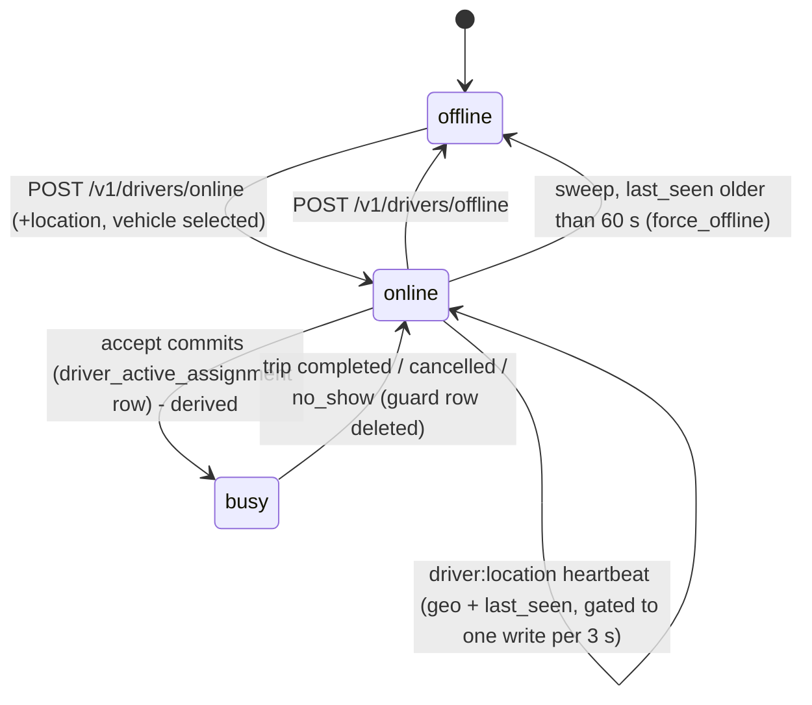

# Driver availability

*The states a driver flows through while operating.*

> Re-verified against the code on 2026-11-09 (RCAB-E8.S14); details and per-edge code references in
> `docs/onboarding/state-machines.md` (sections 6 and 7). Earlier versions of this note described `on_ride` as a
> stored state, Redis as authoritative for dispatch, and the geo entry being dropped on accept. None of that is how the
> code works.

## Where the state lives

- **Redis** `driver:state:<driver_id>` hash (`availability`, `last_seen`, `session_id`, `current_ride_id`): liveness for the staleness sweep and a *projection* of the active trip, rebuilt from Postgres at boot and every 30 s.
- **Redis** `active_drivers` GEO set: cheap nearest-K candidate lookup. **Advisory only.**
- **Postgres** `driver_active_assignment`: the authoritative "this driver is busy" fact (PK `driver_id` = at most one active trip per driver, solo or shared). Offers and the accept transaction re-check it; dispatch filters candidates with an SQL eligibility query (active driver, no assignment, no live offer, vehicle seats), so a stale geo entry cannot produce a double assignment.
- **Postgres** `driver.availability` (`offline` / `online` / `on_ride` allowed by CHECK): denormalised for dashboards. Only `online` / `offline` are ever written; `on_ride` is never set.

"Busy" is therefore a **derived** state, not a stored enum value, and a busy driver **stays in** `active_drivers`; they are excluded from new offers by the SQL eligibility check. The `rcab_busy_drivers` gauge is `count(*)` of `driver_active_assignment`.

## Presence rules

- `driver:location` over the driver's socket refreshes `last_seen` and the geo entry at most once per `REALTIME_GEO_INDEX_GATE_MS` (3 s). While a `current_ride_id` is set, the position is also fanned out to the ride room at <= 1 Hz, and the first packet after accept auto-fires `start_en_route`.
- A cron sweep every `DRIVER_AUTO_OFFLINE_SWEEP_MS` (15 s) forces offline any driver whose `last_seen` is older than `DRIVER_STALE_AFTER_MS` (60 s) and sends `force_offline{reason:'timeout'}`. It calls `goOffline`, which deletes the whole `driver:state` hash; the assignment reconciler re-projects `current_ride_id` for a driver who still holds a trip.
- Going offline never touches a trip the driver is bound to.

## Reconnect handling

On socket (re)connect the gateway replays `driver_state` and emits a `driver:assignment` snapshot built from Postgres, so the app restores `/ride/:id` or `/shared-ride/:id` after a dropout or cold start even if the accept ack was lost.

## See also
- [[entity-driver]] · [[redis-usage]]
- [[journey-driver-go-online]] · [[module-realtime]] · [[module-dispatch]]
