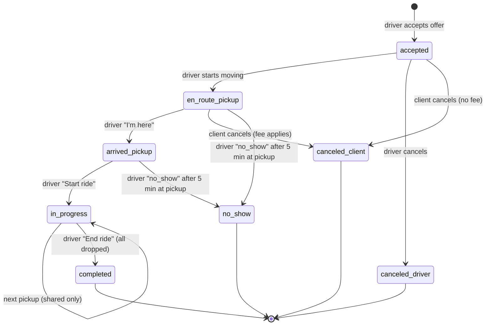

# Ride lifecycle

*From acceptance to completion or cancellation.*

> **As-built status (2026-11-09, RCAB-E8.S14).** The diagram and rule table immediately below are the *original design*
> and differ from the shipped solo machine: states are `requested`, `accepted`, `en_route`, `arrived`, `in_progress`,
> `completed`, `cancelled` (one status, discriminated by `cancelled_by`), `no_driver`, `no_show`; there is no fee in
> Phase-0; `dispatching` exists in the CHECK constraint but is never written. The "As-built" sections further down and
> `docs/onboarding/state-machines.md` (section 1, with the enforcing file for every transition, who may trigger it and
> the events emitted) are authoritative. Scheduled rides add a parked phase (`dispatch_generation = 0`) and a retry loop
> that ends in `no_driver` only past a cutoff after pickup (section 2 of that document).

## Transition rules

| From | Event | To | Notes |
|---|---|---|---|
| `accepted` | `start_en_route` | `en_route_pickup` | implicit on first location update after accept |
| `en_route_pickup` | `mark_arrived` | `arrived_pickup` | within 50m of pickup |
| `arrived_pickup` | `start_ride` | `in_progress` | requires client present (driver attests) |
| `in_progress` | `next_pickup` (shared) | `in_progress` | recompute route via OSRM |
| `in_progress` | `end_ride` | `completed` | all requests delivered |
| any pre-`completed` | `cancel_driver` | `canceled_driver` | reason required |
| any pre-`in_progress` | `cancel_client` | `canceled_client` | fee depends on transition point |
| `en_route_pickup`/`arrived_pickup` | `mark_no_show` | `no_show` | 5-minute wait after arrival |

## Implementation note

State transitions go through a single `RideStateMachine.apply(rideId, driverId, event)` service in [[module-rides]]. The service:

1. SELECTs the current row `FOR UPDATE` inside a transaction.
2. Validates the transition.
3. Writes the new state + audit row.
4. Emits a domain event on `RealtimeBus` ([[module-realtime]]).

This eliminates "what if two updates race" classes of bugs.

## As-built — solo (RCAB-E4.S6)

The solo `rides` table uses the state strings **`en_route`** / **`arrived`** (no `_pickup` suffix — that suffix is a shared multi-stop concept; a solo ride has one pickup and one drop). The forward machine is `RideStateMachine.apply(rideId, driverId, event)` in [[module-rides]], with events `start_en_route` → `mark_arrived` → `start_ride` → `end_ride`. It is driven by the driver over REST (`POST /v1/rides/:id/state`, see [[rest-endpoints]]) and broadcasts `ride_state_changed` to room `ride:<id>` after commit (see [[websocket-events]]). `start_en_route` is an explicit button in E4.S6 (labelled "Head to pickup" since RCAB-E8.S15); **RCAB-E4.S7 added the implicit trigger** — the driver's first location packet after accept (gateway `DRIVER_FIRST_LOCATION_EVENT` → `RidesRealtimeListener` → `RideStateMachine.apply`) auto-fires `start_en_route`, with the button kept as a manual fallback (a duplicate on an already-`en_route` ride is a swallowed no-op). Cancellation / `no_show` transitions are RCAB-E4.S8. Shared rides advance instead through per-stop confirms (`RideLifecycleService`, RCAB-E5.S7).

## As-built — cancellation & no-show (RCAB-E4.S8)

The diagram above shows separate `canceled_driver` / `canceled_client` terminal states; the shipped solo `rides` table uses a **single `cancelled` status discriminated by a `cancelled_by` column** (`'client'` | `'driver'`), plus a distinct **`no_show`** status. The transitions are a role-aware `RideStateMachine.cancel(...)` in [[module-rides]] (separate from the driver-only forward `apply()`):

| Actor | From | Event | To |
|---|---|---|---|
| client | `requested` / `dispatching` / `accepted` / `en_route` / `arrived` | `cancel_client` | `cancelled` |
| driver | `accepted` / `en_route` / `arrived` / `in_progress` | `cancel_driver` (reason required) | `cancelled` |
| driver | `arrived` (after a 5-min wait since `arrived_at`) | `mark_no_show` | `no_show` |

- A client **cannot** cancel once `in_progress` (→ HTTP 409); the trip ends via the driver's `end_ride`.
- The no-show 5-min wait is a **server-side elapsed check** on `arrived_at` (not a background job); reported too early → HTTP 409 `no_show_too_early`.
- **No fee ships in Phase-0** — cancellation is free in every case; the diagram's "fee applies" annotations are future, deferred to a later phase that introduces and activates the fee mechanism (HITL decision 2026-05-31). The columns shipped are `cancelled_at` / `cancelled_by` / `cancel_reason` (no fee column).
- A solo ride whose dispatch exhausts every wave becomes `no_driver` (`RidesRepository.markNoDriver`, system-initiated, hard-fail timer `DISPATCH_HARD_FAIL_MS` = 60 s default). A scheduled ride is re-armed under a new dispatch generation instead, and ends as `no_driver` only once `now > scheduled_for + scheduled.retryCutoffAfterPickupMs` (30 min default).
- On cancel, [[module-rides]] emits `RIDE_CANCELLED_EVENT` so [[module-dispatch]] unwinds any in-flight dispatch (claim, offers, wave/hard-fail timers); a bound driver's `current_ride_id` is cleared and the terminal `ride_state_changed` is broadcast to room `ride:<id>`.

## See also
- [[entity-ride]] · [[sm-booking-flow]] · [[sm-shared-ride-pool]]
- [[module-rides]] · [[module-realtime]] · [[module-dispatch]]
