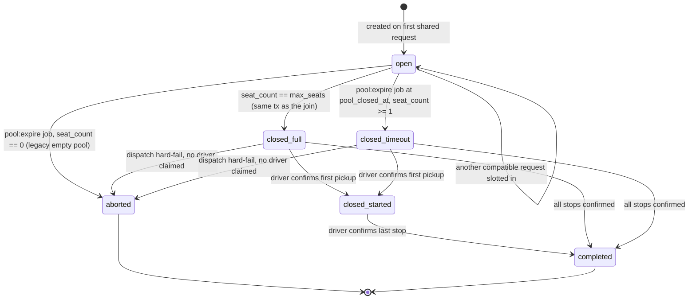

# SharedRide pool

*The life of a [[entity-shared-ride]] from open, through closed-to-joins and dispatch, to completed or aborted.*

> Re-verified against the code on 2026-11-09 (RCAB-E8.S14). The full machine, with a transition table citing the
> enforcing file for every edge, is in `docs/onboarding/state-machines.md` (section 3). **"Claimed" is not a
> `pool_state`**: it is `claimed_by_driver_id IS NOT NULL` on a `closed_full` / `closed_timeout` pool.

## Notes

- A pool can be `closed_*` (no more joiners) yet **not yet started**, while a driver is claiming it or en route to the first pickup.
- `state_version` (bigint) is bumped by a trigger on every UPDATE of the row; Redis projections and `pool:update` events carry it and clients drop anything not newer.
- The state of the *trip itself* once it starts is advanced by per-stop confirmations (`RideLifecycleService.confirmStop`, E5.S7), not by the solo [[sm-ride-lifecycle]] events.
- There is no member-initiated leave in Phase-0; membership (`pool_member.active`) ends only when the pool reaches `aborted` or `completed` (trigger).

## Implementation

- Owned by `PoolLifecycleService` (see [[module-matching]]): `openPool`, `joinPool`, `closeIfOpen`. Every change is ONE Postgres transaction holding the `shared_rides` row lock; `pool_member` + triggers enforce open-state, capacity and one-active-pool-per-passenger even for a writer that forgot to lock.
- `open → closed_full` fires inline in the join transaction when the last seat fills. `open → closed_timeout` fires from a BullMQ delayed job (`matching` queue, name `pool:expire`, job id `pool-expire-<ride_id>`, delay = `MATCHING_POOL_TIMEOUT_MS`, default 60 s), published by the outbox relay from the `pool.expire.schedule` intent written when the pool opened.
- Closure (`closeOpen`) is a guarded `open → closed_*` UPDATE that, in the same transaction, bumps `dispatch_generation`, persists the itinerary to `ride_stops` (2 rows per member) and writes the `pool.dispatch.requested` outbox intent. Redis `pool:<id>` and `pool:update` emits are post-commit and rebuilt from Postgres if lost.
- `aborted` is written by `DispatchService.handleHardFail` → `DriverAssignmentRepository.abortUnclaimedPool` (only for an **unclaimed** pool) after all dispatch waves lapse, or by `closeIfOpen` for an empty open pool. Per-member re-queue into solo dispatch is deferred (owner decision F-5, Stage C contract).
- `closed_full/closed_timeout → claimed`: `claimSharedRow` only stamps `claimed_by_driver_id` + `claimed_at`; the pool state does not change. `closed_started` is written by `markRideStarted` when the first pickup stop is confirmed; `completed` by `markRideCompleted` when the last stop is confirmed (which also releases the driver's assignment guard).

## See also
- [[entity-shared-ride]] · [[features-shared-rides]]
- [[algo-shared-ride-matching]] · [[sm-ride-lifecycle]]
