# CI / CD

*Dockerized Jenkins running in the prod compose stack; GitHub is a plain git remote.*

## Pipeline

```mermaid
flowchart LR
  push[push / PR] --> jenkins[Jenkins]
  jenkins --> lint[Lint + policy drift + tsc]
  lint --> artifact[API artifact checks]
  artifact --> test_unit[Unit tests + coverage floor]
  test_unit --> probe[System probe smoke]
  probe --> test_int[Integration · Testcontainers]
  test_int --> build[Build images once per SHA]
  build --> ident[Image identity check]
  ident --> push_reg[Push to GHCR · main, release/**]
  push_reg --> gate[Manual input gate]
  gate --> deploy[deploy.sh over SSH · migrate · cutover]
  deploy --> verify[verify-release.sh · ready + version == SHA]
  verify -->|fails| rollback[auto-rollback · stage still fails]
```

## Stages: `Jenkinsfile`

| Stage | Commands | When |
|---|---|---|
| `Install` | `pnpm install --frozen-lockfile` | all branches |
| `Lint` | `pnpm lint` · `pnpm policy:doc:check` · build `@rcab/shared` + `@rcab/api-client` · `pnpm -r exec tsc --noEmit` | all branches |
| `API artifact` | `pnpm --filter @rcab/api run test:artifact` · `test:dev-loader` | all branches |
| `Unit tests` | `pnpm --filter @rcab/api run test:cov` (coverage floor) · `pnpm --filter @rcab/web run test` · `pnpm test:probe` | all branches |
| `System probe smoke` | `pnpm system:probe --ci`, archives `system-probe-report.json` | all branches |
| `Integration tests` | `pnpm test:int` (Testcontainers spins up postgres + redis internally; Docker socket must be mounted) | all branches |
| `Build images` | `scripts/deploy/build-images.sh --version $GIT_COMMIT` builds `rcab-api` and `rcab-web` once, tagged with the commit SHA only (no mutable `latest`) | all branches |
| `Image identity check` | OCI revision label, api `RCAB_VERSION`, web `version.json` must equal the SHA | all branches |
| `Push to GHCR` | `docker push ghcr.io/logicthread/rcab-{api,web}:<sha>`, writes and archives `release-manifest.json` (digests) | `main`, `release/**` |
| `Deploy to staging` | `input` gate → `scripts/deploy/deploy.sh` over SSH (pull, one-shot migrator, cutover, `verify-release.sh`, auto-rollback). Exit 10/11 still fail the build. | `main`, `release/**` |

The driver app (Flutter) is **not** built or tested by Jenkins. Run `flutter analyze && flutter test` locally.

Nightly e2e + load tests live in `Jenkinsfile.nightly` (`cron('H 2 * * *')`, isolated compose project, refuses to run if the dev ports are in use). On the 1st of each month it also runs the backup + restore rehearsal. A manual `Jenkinsfile.rollback` job re-deploys a previous SHA. See `scripts/deploy/README.md` for the release scripts, exit codes and rollback limits.

## Jenkins in docker-compose

Jenkins runs as a service in `docker-compose.prod.yml`, bound to `127.0.0.1:8080`. The Jenkins image (`infra/docker/jenkins/Dockerfile`) bundles Docker CLI + Node 20 + pnpm 10 and mounts the host Docker socket for image builds (which makes Jenkins root-equivalent on the host: keep it off the public interface).

Required Jenkins credentials (configure in Jenkins → Manage Credentials) and job environment:

| ID | Type | Used for |
|---|---|---|
| `ghcr-pat` | Secret text | `docker login ghcr.io` (push) |
| `vps-host` | Secret text | SSH target hostname/IP (`PROD_HOST`) |
| `vps-ssh-key` | SSH username + private key | SSH deploy |
| `vps-known-hosts` | Secret file | pinned SSH host key |

Job/folder environment (not in the Jenkinsfile): `NEXT_PUBLIC_*` (public browser config inlined into the web image at build time), `PROD_API_URL` (public https URL of the API; default `https://$PROD_HOST`), optional `PROD_WEB_URL`.

## Branch protections (GitHub)

GitHub branch protection on `main` requires:
- PR before merge
- One review approval

CI status checks are enforced by Jenkins directly — the `input` gate on the deploy stage and the pipeline result block merges conceptually. Optional: install the Jenkins GitHub plugin to post commit statuses back to GitHub PRs.

## Versioning

- Backend & web: every build produces immutable images tagged with the commit SHA; `main` and `release/**` pushes can be deployed after the manual approval gate.
- Driver app: bumped via `pubspec.yaml`; releases tagged `driver-v<x.y.z>`.

## See also
- [[docker-compose]] · [[testing-strategy]] · [[migrations]]
- [[secrets-management]]
