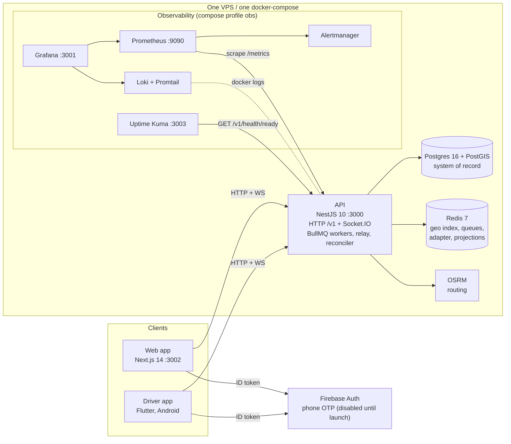

# 01 · System overview

What rcab is, what it is made of, how a request travels through it, and the rules that must never be broken. Read this first; every other page in the pack assumes it.

- Authoritative companions: [`docs/ARCHITECTURE.md`](../ARCHITECTURE.md) (code-verified reference), [`docs/POLICY.md`](../POLICY.md) (every business knob), [`docs/remediation/stage-c-contract.md`](../remediation/stage-c-contract.md) (concurrency contract). Where a vault note disagrees with the code, the code wins.
- Back to the [onboarding README](README.md).

## 1. Product and Phase-0 scope

rcab is a ride-hailing platform for tier-2/3 Indian cities. Phase-0 is a closed pilot, not a launch:

| In scope (shipped) | Out of scope (Phase-0) |
|---|---|
| Passenger web app: Google sign-in (OTP disabled until launch), map-based booking, live tracking, rating | Passenger mobile app, payments, receipts, ride history page (E7.S3) |
| Three ride types: **normal** (private, solo), **shared** (pooled, up to 3 seats), **scheduled** (15 min to 24 h ahead) | Cancellation fees (cancelling is free), surge pricing, promo codes |
| Driver app (Flutter, Android): Google sign-in (OTP disabled until launch), vehicle registration, online toggle, offers, solo and multi-stop rides, rating | Driver earnings dashboard (screen exists, content is a placeholder, E7.S4), in-app driver verification (manual, E9.S1) |
| One city's road graph (dev default: North-East India, Guwahati) | Multi-city, multi-region, Kubernetes, managed cloud (ADR-0009) |
| Metrics, logs, dashboards, uptime checks, encrypted nightly backups, immutable-image release pipeline | Slack/pager alert routing (E8.S2), full dashboards (E8.S1), rating aggregation (E7.S2) |

Phase-0 is **one VPS, one docker-compose** (`99-decisions/ADR-0009-single-vps-phase-0.md`). If a change pulls you toward multi-host or managed services, stop and raise it as an impact-analysis trigger (`95-delivery/impact-analysis.md`).

Work is organised as epics E1 to E9, each ending in a demo. State as of this writing: E1 to E6 shipped (Demo 5 sign-off walk still owed to the owner), E7 (rating aggregation, history, earnings) not started, E8 (hardening) in flight, E9 (pilot) not started. `95-delivery/stories-index.md` is the only source of truth for status.

## 2. Components



| Component | What it does | Where |
|---|---|---|
| **API** | One Node process: REST `/v1/*`, Socket.IO gateway on the same port, BullMQ workers (dispatch, scheduled wake, pool expiry), the outbox relay and reconciler, the auto-offline sweep, the business-metrics sampler | `apps/api` |
| **Web** | Passenger app. Next.js 14 App Router, Zustand stores, Leaflet/OSM map, Nominatim address search, Firebase client auth, Socket.IO client. Routes: `/` (landing page linking to sign-in and booking), `/signin`, `/book` | `apps/web` |
| **Driver app** | Flutter, feature-first, Riverpod, Dio, Socket.IO, Firebase Auth, foreground location service. Outside the pnpm workspace | `apps/driver-app` |
| **Postgres** | System of record for users, sessions, rides, pools, members, offers, assignment guard, ratings, outbox, idempotency. Migrations are hand-written SQL | `apps/api/migrations`, `apps/api/src/db/schema.ts` |
| **Redis** | Rebuildable projection only: the driver geo index (`active_drivers`), driver presence hashes, `pool:<id>` hashes, BullMQ queues, Socket.IO adapter, OSRM distance cache. Losing it never loses a booking (reconciler rebuilds) | |
| **OSRM** | Self-hosted routing: quote distance/duration, route geometry for the map and for pool similarity, itinerary legs for seat pricing. Dev graph is built from a Geofabrik extract on first `dev:up` | compose service `osrm` |
| **BullMQ** | Delayed and retried jobs on three queues: `dispatch` (start, wave 2, hard-fail), `scheduled-dispatch` (wake), `matching` (pool expiry) | Redis |
| **Outbox** | The transactional bridge between a Postgres commit and a BullMQ job. See section 5 | `modules/outbox` |
| **Observability** | Prometheus scrapes `/metrics`, Grafana shows dashboards, Promtail ships container logs to Loki, Alertmanager receives alerts, Uptime Kuma pings readiness | `infra/observability`, compose profile `obs` |

Local ports (dev compose): api 3000, web 3002, grafana 3001, uptime-kuma 3003, prometheus 9090, redis 6379, **postgres 55432**. OSRM, Loki and Alertmanager publish no host port; reach them inside the compose network (`docker compose ... exec -T api sh -c 'curl http://osrm:5000/...'`).

## 3. Request lifecycle

```mermaid
sequenceDiagram
  participant C as Client
  participant MW as Middleware
  participant G as Guards and pipes
  participant H as Controller and service
  participant DB as Postgres
  participant Q as Outbox and BullMQ
  participant RT as Socket.IO
  C->>MW: HTTP request (Bearer access token)
  MW->>MW: RequestIdMiddleware sets x-request-id; MetricsMiddleware starts timer
  MW->>G: AuthGuard verifies HS256 JWT (iss rcab, aud rcab-api, typ access)
  G->>G: ValidationPipe (whitelist, transform) validates the DTO
  G->>H: handler runs, role check in the controller
  H->>DB: one transaction, row locks, outbox row written in the same commit
  H-->>C: JSON response
  Note over H,RT: after commit only
  H->>RT: emit to rooms (user, driver, ride, pool)
  H->>Q: kick the relay; relay publishes the BullMQ job
  MW->>MW: on finish: observe http_request_duration_seconds, log one "request" line
```

Facts worth knowing:

- Order of cross-cutting pieces is in `apps/api/src/app.module.ts`: `RequestIdMiddleware` and `MetricsMiddleware` on every route, a global `ValidationPipe({ whitelist: true, transform: true })`, a global `AppExceptionFilter`. `main.ts` adds `cookie-parser` and CORS with credentials from `CORS_ORIGINS`.
- Every error response has one shape: `{ "error": { "code", "message", "request_id" } }`. `request_id` is the `x-request-id` header (also returned on every response), which is the key to find the same request in Loki.
- Roles (`client`, `driver`) are checked inside controllers (`assertClient`, `assertDriver`), not by decorators.
- Throttling is applied only on the auth controller (see [auth-and-sessions](functionality/auth-and-sessions.md)); other routes are not rate limited in Phase-0.
- Business policy (fares, radii, TTLs, windows, rate limits) is read once at boot through `getPolicy()` / the injected `POLICY`, validated, and frozen. A bad value stops the API from starting. Everything is listed in [`docs/POLICY.md`](../POLICY.md).

## 4. Data flow: one normal ride

```mermaid
sequenceDiagram
  participant P as Passenger web
  participant A as API
  participant DB as Postgres
  participant R as Redis geo
  participant Dr as Driver app
  P->>A: POST /v1/rides/quote (type=normal)
  A-->>P: fare, distance, route geometry, signed quoteToken (5 min)
  P->>A: POST /v1/rides + Idempotency-Key + quoteToken
  A->>DB: INSERT rides(requested) + outbox ride.dispatch.requested (one txn)
  A-->>P: rideId, status requested
  P->>A: WS ride:subscribe (rideId)
  A-->>P: ride:snapshot
  A->>R: outbox relay -> BullMQ dispatch:start -> GEORADIUS active_drivers
  A->>DB: dispatch_offer rows (wave 1)
  A-->>Dr: ride_offer (offerId, pickup, dropoff, fare, ttlMs)
  Dr->>A: WS ride_offer_response accept
  A->>DB: accept txn: lock ride, lock offer, driver_active_assignment guard, bind driver
  A-->>Dr: ack + ride_offer_outcome assigned
  A-->>P: ride_state_changed accepted
  Dr->>A: WS driver:location (5 s); first packet implies en_route
  A-->>P: driver_location (1 Hz), ride_state_changed en_route
  Dr->>A: POST /v1/rides/:id/state mark_arrived, start_ride, end_ride
  A-->>P: ride_state_changed arrived, in_progress, completed
  P->>A: POST /v1/rides/:id/ratings
```

The full state machines (ride, offer, pool, driver presence, session) are in [state-machines.md](state-machines.md). Per-area detail is in the [functionality pages](functionality/).

## 5. Key invariants

These are enforced by Postgres constraints, triggers and transaction design, not by good manners. Break one and tests (including the invariant SQL in the Stage C contract, section 6) fail.

| Invariant | Mechanism |
|---|---|
| **One active trip per driver**, across solo and shared | `driver_active_assignment` (primary key `driver_id`, unique trip ids), inserted in the accept transaction, deleted in the transaction that ends the trip |
| **An offer is accepted at most once, by its recipient, before its DB-clock deadline, for the current dispatch generation** | One accept transaction against `dispatch_offer`; partial unique indexes allow one live offer per driver and one accepted offer per trip generation |
| **Committed intent is never lost** (outbox) | The business commit writes an `outbox` row; `OutboxRelay` leases due rows and publishes deterministic BullMQ jobs; `DispatchReconciler` rebuilds anything missing from Postgres at boot and every 5 minutes |
| **Redis is a projection** | Offers, claims, seat counters live in Postgres. `pool:<id>`, `driver:state:<id>.current_ride_id` and queues are rebuilt from it |
| **Stale work is harmless** | Every job, offer and outbox row carries `dispatch_generation`; consumers with an older generation do nothing and report success |
| **Post-commit side effects only** | Socket emits, Redis writes, queue removals happen after the transaction commits; a failure is logged and repaired, never turned into an API error |
| **Seats never exceed capacity** | `pool_member` rows + triggers + CHECK; `shared_rides.seat_count` is derived by trigger, never written by code |
| **A retried create never double-books** | `Idempotency-Key` scoped to account + operation, bound to a request fingerprint, durable in Postgres |
| **Realtime is ordered by version** | Solo version = rank of the status; pool version = `shared_rides.state_version` (trigger-bumped). Clients drop events that are not newer |
| **Config fails closed** | Policy schema validates every knob and cross-field rule at boot; `JWT_SECRET` and `CORS_ORIGINS` are mandatory outside development/test |

Lock order for any transaction: trip row, then offer rows, then assignment guard, then `pool_member` / `ride_stops`, then `outbox` / idempotency. No transaction locks two trip rows, none calls the network (OSRM, Redis, BullMQ) while holding a lock, and deadlines are compared on the DB clock.

## 6. Repo layout

```
apps/
  api/                 NestJS 10
    src/
      main.ts          bootstrap, CORS, cookie-parser
      app.module.ts    wires everything
      config/policy/   typed, validated business policy (policy.schema.ts is the source of truth)
      common/          guards (auth, csrf, access-token, auth-config), middleware (request-id, metrics), filters, utils
      infra/           db (Drizzle+pg), redis (ioredis), firebase (admin), google (verifier)
      modules/         auth, vehicles, drivers, realtime, rides, rating, pricing, dispatch, matching,
                       ride-lifecycle, scheduled, outbox, metrics, health
      db/schema.ts     the single Drizzle schema (15 tables); db/constraints.ts maps constraint names to typed errors
      metrics.ts       every prom-client metric
      migrate.ts       the SQL migration runner
    migrations/        0001..0017 hand-written SQL
    test/integration/  Testcontainers suites (real Postgres + Redis)
  web/                 Next.js 14: src/app (/, /signin, /book), src/lib (auth, booking, geo), src/config/policy.ts, e2e/
  driver-app/          Flutter: lib/core (auth, api, location, realtime, driver), lib/features/*, lib/di, test/, integration_test/
packages/
  shared/              shared TS types (currently only Health)
  api-client/          placeholder; typed client not generated yet
  test-fixtures/       unique test data, migration runner for integration tests
infra/
  docker/              compose: dev, test, prod, prod-test, recovery-drill, release-sim; api/web/nginx/postgres/backup/jenkins
  observability/       prometheus.yml, alert_rules.yml, alertmanager.yml, loki.yml, promtail.yml, grafana dashboards + provisioning
  load/                k6 scenarios and the generated perf budget
scripts/               dev-up, dev-smoke, seed-dev, obs-smoke, prod-*, deploy/ (release pipeline), recovery/ (drills), codegraph/, policy-doc.ts, setup-uptime-kuma.ts
codegraph/             graph.json + graph.md (queryable code graph, regenerate with pnpm code:graph)
docs/                  ARCHITECTURE, POLICY, manual-testing/, operations/, remediation/, artifacts/, onboarding/ (this pack)
00-index/ ... 99-decisions/   Obsidian vault: design, domain, backend, clients, algorithms, infra, quality, delivery, ADRs
.claude/               project skills (/pickup-story, /smoke-check, /db-migrate, ...) and hooks
```

## 7. Glossary

| Term | Meaning |
|---|---|
| **Client / passenger** | A user with role `client`. Anyone who signs in with a phone number becomes one |
| **Driver** | A user with role `driver` and a row in `driver`. There is no self-service path: an operator promotes the account in SQL (manual verification, E9.S1) |
| **Solo / normal / private ride** | One passenger, one driver, row in `rides` with `type=normal`. The web UI calls it "Private" |
| **Shared ride / pool** | Up to 3 passengers sharing one driver. Row in `shared_rides` (the pool) plus one `pool_member` per passenger. The pool id is also the shared trip id |
| **Scheduled ride** | A `rides` row with `type=scheduled` and a future `scheduled_for`; woken at pickup minus 10 minutes |
| **Quote token** | Short-lived signed JWT (issuer `rcab-quote`, 5 min) carrying the fare and route the client was shown; `POST /v1/rides` locks that fare |
| **Dispatch** | Finding a driver: offer the trip to the nearest eligible drivers in waves |
| **Wave** | One round of offers. Wave 1 uses K1 nearest within R1, wave 2 widens to K2 within R2 |
| **Offer** | A `dispatch_offer` row: this driver may accept this trip until `expires_at` |
| **Generation** | `dispatch_generation`: version of one dispatch attempt for a trip. Bumped on re-arm so stale jobs and offers are ignored |
| **Assignment guard** | `driver_active_assignment`: the row that says "this driver is busy with this trip" |
| **Outbox** | Table of work to publish, written in the same transaction as the business change |
| **Relay** | In-process loop that leases outbox rows and publishes BullMQ jobs |
| **Reconciler** | Loop that rebuilds missing jobs from Postgres (boot and every 5 min) |
| **Projection** | A Redis copy of something Postgres owns (pool hash, driver `current_ride_id`) |
| **Snapshot** | Authoritative state read from Postgres and sent when a socket subscribes (`ride:snapshot`, `pool:snapshot`, `driver:assignment`) |
| **Presence** | A driver being in the Redis geo index with a fresh `last_seen` |
| **Sweep** | The 15 s job that forces drivers silent for 60 s offline |
| **paise / `fareCents`** | Money is integer paise (1/100 rupee) in INR. Fields are named `*Cents` historically; the currency is always `INR` |
| **HITL** | Human-in-the-loop stop: ADRs, secrets, real VPS deploys, demo sign-off and a few others need the owner (`95-delivery/hitl-touchpoints.md`) |
| **Story / demo** | Unit of delivery (`RCAB-Ex.Sy`) / the epic-level sign-off walk (`95-delivery/demo-cadence.md`) |
