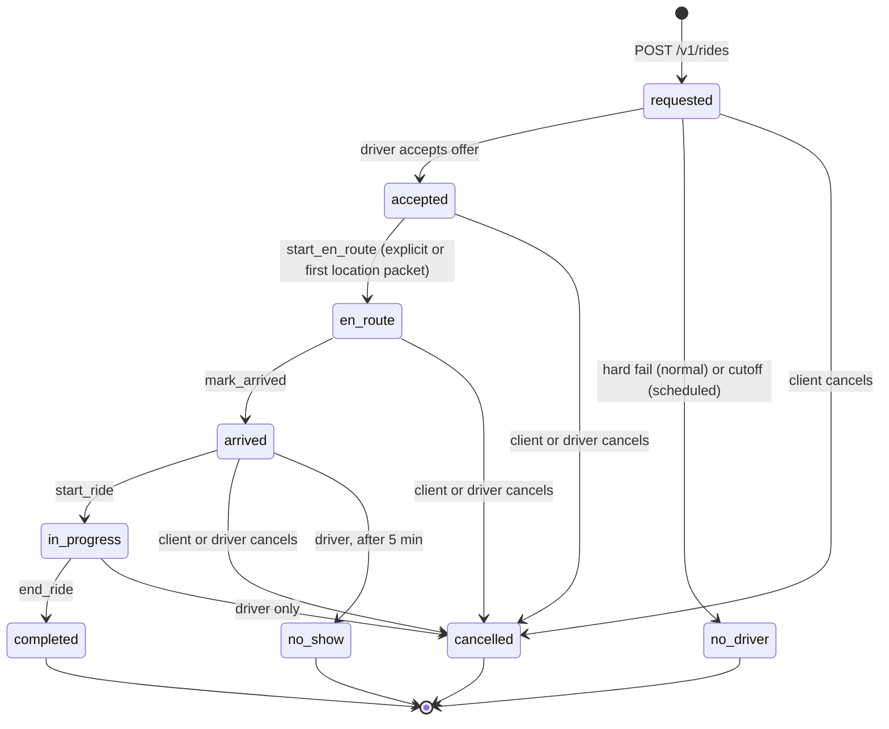

# Ride lifecycle, cancel and no-show

How a **solo** ride moves from `accepted` to a terminal state, who is allowed to move it, and what cancel and no-show do. (A shared trip is driven by stop confirmations instead; see [shared-rides](shared-rides.md).)

Back to [README](../README.md) · see also [normal-booking](normal-booking.md), [dispatch-and-offers](dispatch-and-offers.md), [realtime-protocol](realtime-protocol.md) · diagrams: [state-machines](../state-machines.md) · vault: `30-domain/sm-ride-lifecycle.md`.

## States

`rides.status`: `requested`, `accepted`, `en_route`, `arrived`, `in_progress`, `completed`, `cancelled`, `no_driver`, `no_show`. (`dispatching` is allowed by the CHECK but never written.) Terminal: `completed`, `cancelled`, `no_driver`, `no_show`.

## Forward transitions (driver only)

`POST /v1/rides/:id/state` with `{ "event": ... }`:

| Event | From | To | Timestamp set |
|---|---|---|---|
| `start_en_route` | `accepted` | `en_route` | `en_route_at` |
| `mark_arrived` | `en_route` | `arrived` | `arrived_at` |
| `start_ride` | `arrived` | `in_progress` | `started_at` |
| `end_ride` | `in_progress` | `completed` | `completed_at` (and the driver's assignment guard is released) |

The repository runs `SELECT ... FOR UPDATE` on the ride, checks the caller is the **bound driver** (`not_owner` is 403) and that the current status equals the expected `from` (`invalid_transition` is 409), then updates in the same transaction. After commit it emits `ride_state_changed { rideId, state, by: "driver" }` to the ride room and, on completion, clears `driver:state.current_ride_id`. Unknown event: 400 `invalid_event` (rejected by the DTO before that). Unknown ride: 404 `ride_not_found`.

**Implicit en route.** The first `driver:location` packet received while the driver has a `current_ride_id` fires `ride-lifecycle.driver_first_location`; `RidesRealtimeListener` applies `start_en_route`. If the driver already tapped the button, the second application is a harmless no-op (debug log only).

## Cancel and no-show

`POST /v1/rides/:id/cancel`, body `{ reason?: string (max 500), event?: "mark_no_show" }`.

| Actor | Allowed from | Notes |
|---|---|---|
| Client (the ride's passenger) | `requested`, `accepted`, `en_route`, `arrived` (policy `rides.clientCancellableFrom`) | Not `in_progress`. Reason optional. The web hides the button once the trip starts |
| Driver (the bound driver) | `accepted`, `en_route`, `arrived`, `in_progress` (policy `rides.driverCancellableFrom` also lists `requested`, unreachable because the driver must already be bound) | **Reason required**: 400 `reason_required`. The app offers "Passenger not reachable", "Vehicle issue", "Other" |
| Driver, `event: "mark_no_show"` | `arrived` only, and only once `now - arrived_at >= RIDE_NO_SHOW_WAIT_MS` (5 min) | 409 `no_show_too_early` before that; 403 for a client. Result `no_show`, `cancelled_by = driver`, `cancel_reason = "no_show"` |

Errors: 403 `forbidden` (not your ride, wrong role), 404 `ride_not_found`, 409 `invalid_transition` (state not cancellable for that actor, or no-show from the wrong state). Response `{ rideId, status, cancelledBy }`. Cancelling is **free** in Phase-0 (no fee column exists).

What the cancel transaction does (all in one commit, under the ride row lock): stamp `cancelled_at`, `cancelled_by` (`client`|`driver`), `cancel_reason`; set status `cancelled` or `no_show`; revoke every live offer; delete the bound driver's `driver_active_assignment`. After commit: `ride_state_changed` to the ride room (`by` = the actor), `ride_offer_revoked` + outcome to drivers whose offers were revoked, clear the driver's `current_ride_id`, emit `ride.cancelled` so dispatch removes the wave-2 and hard-fail timers, and for a scheduled ride remove the wake job. Accept and cancel take the same row lock first, so exactly one of them wins a race.

A driver-initiated cancel ends the ride as `cancelled`; it is **not** re-dispatched to another driver. The passenger sees "Ride cancelled" and must book again.

## User-visible behaviour

| Scenario | Passenger sees | Driver sees | Video |
|---|---|---|---|
| Passenger cancels before pickup | "Ride cancelled" | The ride screen ends and returns home | W04 |
| Driver cancels (with reason) | "Ride cancelled" | Back to home | W05, D07 |
| Driver no-show | "Marked as no-show" | "Report no-show (wait 5 min)" becomes enabled when the wait elapses | W05, D07 |
| Normal completion | "Trip complete" + rating card | Rating screen | W03, D04 |

Scene IDs: [W03 to W05](../videos/web/INDEX.md), [D04, D07](../videos/driver/INDEX.md).

## Metrics

`rcab_ride_state_transition_total{from,to}` counts every committed transition (including `none -> requested`). `rcab_dispatch_outcome_total{outcome="cancelled"}` counts rides cancelled while still being dispatched.

## Data

`rides` (`status`, `accepted_at`, `en_route_at`, `arrived_at`, `started_at`, `completed_at`, `cancelled_at`, `cancelled_by`, `cancel_reason`, `driver_id`, `dispatch_generation`), `driver_active_assignment`, `dispatch_offer`. Migrations 0006 to 0009.

## Policy knobs

[Ride lifecycle](../../POLICY.md#ride-lifecycle): `RIDE_NO_SHOW_WAIT_MS` (5 min), code-fixed `rides.clientCancellableFrom` and `rides.driverCancellableFrom` (edit in `policy.schema.ts`). The driver app mirrors the wait as `noShowWait` ([driver app knobs](../../POLICY.md#driver-app)).

## Code entry points

API: `modules/rides/{rides.controller (transition, cancel), ride-state-machine.service, rides.repository (transition, cancel, markNoDriver), rides-realtime.listener}.ts`; `modules/dispatch/dispatch.service.ts` (`onRideCancelled`); `modules/scheduled/scheduled.service.ts` (`cancelWake`). Web: `app/book/ride-tracking-panel.tsx`, `lib/booking/store.ts`. Driver app: `features/ride/{ride_screen,ride_provider,ride_models}.dart`.

Driver-app behaviour added under RCAB-E8.S14: the ride screen now follows the ride live (`ride:subscribe` plus `ride_state_changed`), so a passenger cancel or a server-side transition is shown without the driver tapping a button; on a terminal cancel/no-show the app returns home with a notice ("The passenger cancelled this ride", "Ride cancelled", "Ride closed as a passenger no-show").

## Tests

Unit: `ride-state-machine.service.spec.ts`, `rides.controller.spec.ts`, `rides-realtime.listener.spec.ts`. Integration: `ride-state-machine.int.spec.ts` (races: transition vs cancel vs accept), `ride-realtime.int.spec.ts`. Web: `ride-tracking-panel.test.tsx`, `book-client.test.tsx`. Driver app: `test/features/ride/`.

## Known gaps

- No re-dispatch after a driver cancel; no penalty or tracking of driver cancellations.
- The no-show wait is measured from the server's `arrived_at`, but the comparison uses the API process clock (`new Date()`), not the DB clock; negligible on one host.
- A passenger cannot cancel once the trip is `in_progress` (policy), even if the driver is stuck.
- `rides.status` and the policy lists still contain `dispatching` although the code never enters it (`docs/ARCHITECTURE.md` and `30-domain/sm-ride-lifecycle.md` now say so); removing it needs a migration and is not scheduled.
- Web reload after a no-show used to restore the terminal ride; fixed in `fd8b2ca` (see [normal-booking](normal-booking.md)).
