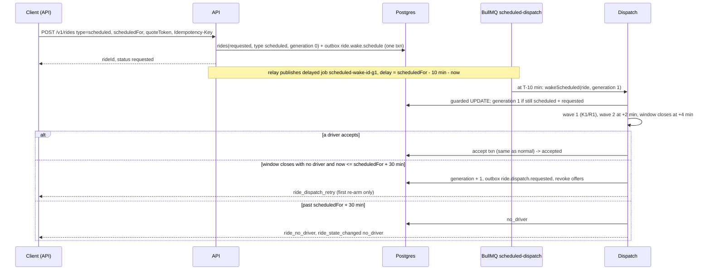

# Scheduled rides

A ride booked 15 minutes to 24 hours ahead. Nothing is dispatched at booking time: a delayed job wakes the ride 10 minutes before pickup and the **normal solo dispatch path** takes over, with a longer 4-minute accept window and an automatic retry instead of giving up.

Back to [README](../README.md) · reuses [normal-booking](normal-booking.md) and [dispatch-and-offers](dispatch-and-offers.md); durability in [idempotency-and-durability](idempotency-and-durability.md) · diagrams: [state-machines](../state-machines.md) · product spec: `10-product/features-scheduled-booking.md`.

## What it does

After a driver accepts, everything (en route, arrived, in progress, completed, cancel, no-show, rating) is exactly the normal solo ride.

## Booking rules

- `POST /v1/rides` with `type: "scheduled"`, `scheduledFor` (ISO-8601, any offset), `quoteToken` and an `Idempotency-Key`. Quote first with `type` `normal` or `scheduled`; the scheduled quote is priced like a normal one and the token is not tied to the ride type.
- The pickup must be between `SCHEDULED_MIN_LEAD_MS` (15 min) and `SCHEDULED_MAX_LEAD_MS` (24 h) from now; otherwise 400 `scheduled_for_out_of_window`. Missing time: 400 `scheduled_for_required`. A replay of an already committed booking is resolved before the window check, so a late retry still recovers the ride.
- Idempotency operation is `ride.create.scheduled`; `scheduledFor` is part of the request fingerprint (normalised to epoch ms, so `Z` and `+05:30` spellings of one instant are the same intent).
- Because wake lead (10 min) is shorter than the minimum lead (15 min), a ride always wakes at least 5 minutes after it is booked. The wake delay is clamped to 0, so a time already in the past fires immediately.

## Windows and retry (defaults)

| Moment | What happens | Knob |
|---|---|---|
| T minus 10 min | Wake: the ride gets dispatch generation 1 and wave 1 runs (K1 = 5 within 2 km, offers TTL 12 s) | `SCHEDULED_WAKE_LEAD_MS` |
| +2 min | Wave 2 (K2 = 10 within 4 km) | `SCHEDULED_DISPATCH_WAVE_ONE_MS` (half the window) |
| +4 min | Window closes. Not expired: the ride is re-armed under generation + 1, live offers revoked, a fresh `ride.dispatch.requested` outbox row published | `SCHEDULED_DISPATCH_WINDOW_MS` |
| Every following window | Repeats silently. The passenger is told once (`ride_dispatch_retry { rideId, retryCount, retryUntil }` on the first re-arm) | |
| `scheduledFor` + 30 min | The first window that closes after this moment ends the ride as `no_driver` | `SCHEDULED_RETRY_CUTOFF_AFTER_PICKUP_MS` |

There is no cap on the number of retries, only the time cutoff. The retry count is `dispatch_generation - 1` and is counted in `rcab_dispatch_outcome_total{outcome="scheduled_retry"}`; cutoff endings use `outcome="scheduled_no_driver"`. Cancel, accept and the cutoff are mutually exclusive because they all take the ride row lock first.

The passenger snapshot (`ride:snapshot`) carries `retryUntil` (ISO) only while a scheduled ride is woken, `requested` and unassigned, so a client can say "we'll keep trying until 10:30". The web banner for that is implemented (`searchingBanner`).

## Cancelling

`POST /v1/rides/:id/cancel` by the passenger works from `requested` (before and after the wake). The controller then removes the pending wake job (`ScheduledDispatchService.cancelWake`, best effort). Even if a wake fires anyway, `wakeScheduled`'s guarded `UPDATE ... WHERE status = 'requested'` matches nothing and the job is a no-op. A cancel after a driver accepted follows the normal rules ([ride-lifecycle-cancel-no-show](ride-lifecycle-cancel-no-show.md)). Free of charge.

## User-visible behaviour and videos

- The web booking screen **has no scheduled option** (`apiRideType` maps only `shared` and `normal`). Scheduled rides are created through the API (curl or a test harness) and then observed. Video W08 therefore shows: create, the `requested` state with the searching message once woken, and cancel. See the [web index](../videos/web/INDEX.md).
- Driver: the offer looks like any solo offer (no label says "scheduled"); D04 covers the common path.
- Manual walk: [RUN-GUIDE](../../manual-testing/RUN-GUIDE.md) section 7 (Demo 5). To test without waiting, set `SCHEDULED_WAKE_LEAD_MS` and `SCHEDULED_MIN_LEAD_MS` small in the dev env (cross-field rule: min < max; wave-one <= window).

## API and events

`POST /v1/rides` (above), `GET /v1/rides/:id`, `POST /v1/rides/:id/cancel`. Socket: `ride:subscribe`/`ride:snapshot` (with `retryUntil`), `ride_dispatch_retry` (to `user:<passenger>`), `ride_no_driver`, `ride_state_changed`.

## Data

`rides.type = 'scheduled'`, `rides.scheduled_for`, `rides.dispatch_generation` (0 means not yet woken), outbox topics `ride.wake.schedule` and `ride.dispatch.requested`. Redis: queue `bull:scheduled-dispatch:*`, job id `scheduled-wake-<rideId>-g<g>`. Migration 0011 (scheduled columns) and 0014/0015 (generation, outbox).

## Policy knobs

[Scheduled booking](../../POLICY.md#scheduled-booking): `SCHEDULED_MIN_LEAD_MS`, `SCHEDULED_MAX_LEAD_MS`, `SCHEDULED_WAKE_LEAD_MS`, `SCHEDULED_DISPATCH_WINDOW_MS`, `SCHEDULED_DISPATCH_WAVE_ONE_MS`, `SCHEDULED_RETRY_CUTOFF_AFTER_PICKUP_MS`, `SCHEDULED_DISPATCH_CONCURRENCY` (5 wake jobs in parallel). Cross-field rules in [POLICY](../../POLICY.md#cross-field-rules).

## Code entry points

`modules/scheduled/{scheduled.service,scheduled.processor,scheduled-retry,scheduled-window}.ts`; `modules/dispatch/dispatch-start.service.ts` (`wakeScheduled`); `modules/dispatch/dispatch.service.ts` (`handleHardFail`, `retryScheduledRide`); `modules/rides/rides.controller.ts` (`createScheduled`, `cancel`); `modules/outbox/dispatch-reconciler.service.ts` (re-arms unwoken rides and expired windows).

## Tests

Unit: `scheduled.service.spec.ts`, `scheduled.processor.spec.ts`, `scheduled-window.spec.ts`, `dispatch-start.service.spec.ts`, `dispatch.service.spec.ts`. Integration: `scheduled-dispatch.int.spec.ts`, `scheduled-retry.int.spec.ts`, `outbox-e2e.int.spec.ts`. Web: `ride-tracking-panel.test.tsx` (searching banner), `lib/booking/store.test.ts`.

## Known gaps

- **No web UI to book a scheduled ride** (and no list of upcoming rides). The state machine, API, retry and the searching banner exist; the picker does not.
- The restore-on-reload marker (`rcab_active_ride`) is only written by the solo booking path, so a scheduled ride created elsewhere is not rehydrated by the web.
- No reminder or push notification before pickup; no "driver assigned" notification other than the socket event.
- The driver sees an accepted scheduled ride immediately (about 10 minutes before pickup) and is bound to it; there is no separate "upcoming trips" list.
- A scheduled ride sits in `requested` for up to 24 h plus 30 min; any query that counts "open requests" by status alone includes un-woken scheduled rides (filter on `dispatch_generation >= 1` to see only those being dispatched).
