# State machines — the whole system, derived from the code

> Audience: engineers taking over rcab. Every diagram below was derived from the code as of branch
> `onboarding/walkthrough` (post Stage C remediation, migrations up to `0017`). Where a vault note or an older
> doc disagrees with the code, **the code wins** — the "Drift notes" at the end of each section list the
> differences we found so you do not trip on them.
>
> Related documents: [`docs/ARCHITECTURE.md`](../ARCHITECTURE.md) (the why) ·
> [`docs/POLICY.md`](../POLICY.md) (every timer and threshold mentioned here) ·
> [`docs/remediation/stage-c-contract.md`](../remediation/stage-c-contract.md) (lock order, outbox contract, invariants) ·
> vault notes `30-domain/sm-*.md` (the original design intent; partly superseded, see drift notes).
> Workflows that touch these machines: [`workflows/testing.md`](workflows/testing.md),
> [`workflows/debugging-and-tooling.md`](workflows/debugging-and-tooling.md).

## How to read this document

- **Source of truth for state is Postgres.** Redis (`pool:<id>` hashes, `driver:state:<id>`, geo index, BullMQ) and
  Socket.IO rooms are rebuildable projections. Every transition below commits in Postgres first; sockets, Redis
  projections and BullMQ timers are touched strictly *after* commit and are repaired by the reconciler if a step is lost.
- **Mutual exclusion is row locks.** Ride accept, cancel, hard-fail, scheduled retry, and stop confirmation all take
  the same `SELECT … FOR UPDATE` on the trip row first (lock order: trip row -> offer row -> assignment guard;
  `shared_rides` -> `pool_member`). Exactly one of two racing writers commits its outcome.
- **"Emitted" columns name Socket.IO events.** Rooms: `ride:<id>` (solo ride parties), `pool:<id>` (pool members),
  per-user and per-driver rooms (`toUser`, `toDriver`). Event vocabulary: vault `40-backend/websocket-events.md`;
  wire shapes: `apps/api/src/modules/realtime/realtime.protocol.ts`.
- **Video scenes.** Scene IDs (W01–W10 web, D01–D08 driver app, M01–M06 ops) are indexed in
  [`videos/web/INDEX.md`](videos/web/INDEX.md), [`videos/driver/INDEX.md`](videos/driver/INDEX.md) and
  [`videos/ops/INDEX.md`](videos/ops/INDEX.md). Files live at `docs/onboarding/videos/<area>/<ID>-<slug>.mp4`; the
  index has the exact slug and a one-line description of every scene.

### Machine inventory

| # | Machine | Where the state lives | Enforcing code |
|---|---|---|---|
| 1 | [Solo ride](#1-solo-ride-ridesstatus) | `rides.status` | `modules/rides/ride-state-machine.service.ts`, `rides.repository.ts`, `dispatch.service.ts` |
| 2 | [Scheduled ride](#2-scheduled-ride) | `rides` (`type='scheduled'`, `dispatch_generation`) + outbox + BullMQ | `modules/scheduled/*`, `dispatch-start.service.ts` |
| 3 | [Shared pool](#3-shared-pool-shared_ridespool_state) | `shared_rides.pool_state`, `claimed_by_driver_id`, `state_version` | `modules/matching/pool-lifecycle.service.ts`, `ride-lifecycle.service.ts`, `dispatch/assignment.repository.ts` |
| 4 | [Pool member](#4-pool-member-pool_memberactive) | `pool_member.active` | `pool-membership.repository.ts` + 0016 triggers |
| 5 | [Dispatch offer](#5-dispatch-offer-dispatch_offerstate) | `dispatch_offer.state` | `dispatch/offer.repository.ts`, `dispatch.service.ts` |
| 6 | [Driver presence](#6-driver-presence) | Redis `driver:state:<id>` + `active_drivers` geo + `driver.availability` | `modules/drivers/drivers.service.ts`, `realtime.gateway.ts` |
| 7 | [Driver active assignment](#7-driver-active-assignment-the-exclusivity-guard) | `driver_active_assignment` row | `dispatch/assignment.repository.ts` |
| 8 | [Refresh-token session family](#8-refresh-token-session-family) | `auth_refresh_token` | `modules/auth/auth.service.ts` |
| 9 | [Outbox intent](#9-outbox-intent) | `outbox` | `modules/outbox/*` |
| 10 | [Idempotency record](#10-idempotency-record) | `idempotency_record` (+ `rides` unique scope) | `modules/rides/idempotency*.ts` |
| 11 | [Web booking stage](#11-web-booking-stage-machine) | Zustand `useBookingStore` | `apps/web/src/lib/booking/store.ts` |
| 12 | [Driver app controllers](#12-driver-app-offer-ride-and-shared-ride-controllers) | Riverpod notifiers | `apps/driver-app/lib/features/{offer,ride,shared_ride}` |

---

## 1. Solo ride (`rides.status`)

Applies to `type = 'normal'` rides, and to `type = 'scheduled'` rides once they are woken (section 2 adds the
pre-dispatch phase). Allowed values are pinned by the `rides_status_check` constraint.

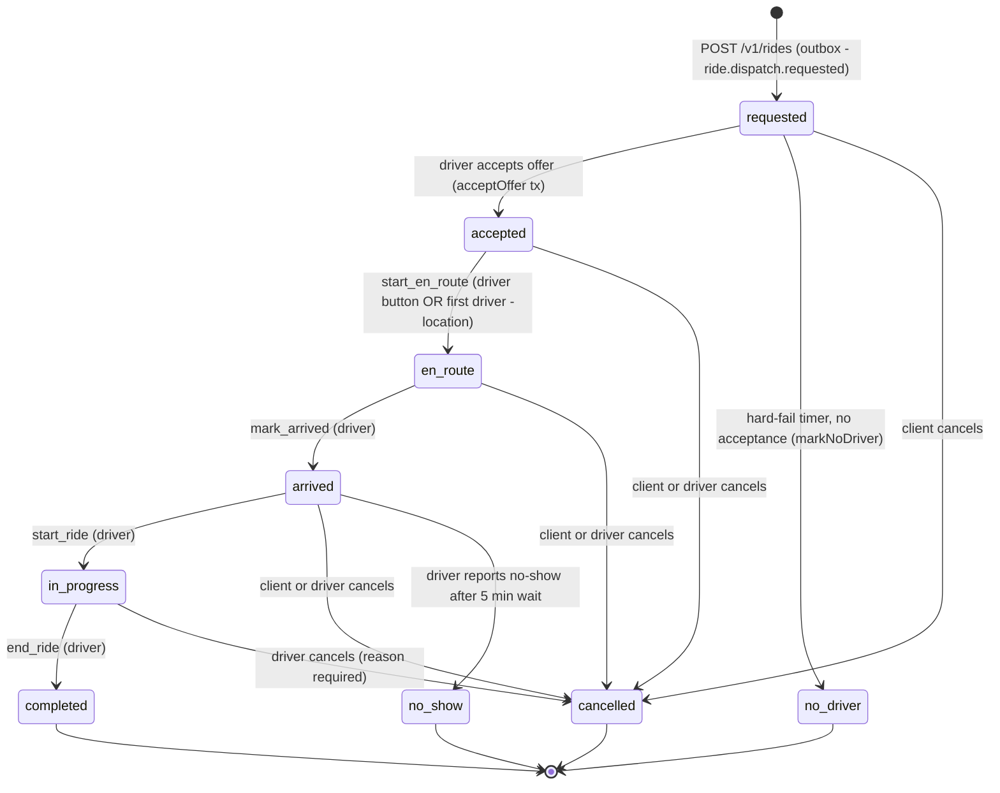

`dispatching` is in the CHECK constraint, in the policy `clientCancellableFrom` / `driverCancellableFrom` lists and
in the realtime rank table, but **no code path ever writes it**: a ride stays `requested` for its whole search
(waves, retries and all). Treat it as a reserved value.

### Transition table

| From | Event / trigger | Who may trigger | Guard (all under `SELECT … FOR UPDATE` of the ride row) | To | Side effects (in the same tx unless noted) | Emitted after commit | Enforced in |
|---|---|---|---|---|---|---|---|
| — | `POST /v1/rides` `type=normal` (needs `quoteToken`, `Idempotency-Key`) | client | idempotency scope `(passenger, ride.create.solo, key)` + request fingerprint (section 10) | `requested` (generation 1) | insert ride + outbox `ride.dispatch.requested` g1; metric `recordRideTransition('none','requested')` | none from the create itself; client then sends `ride:subscribe` | `rides.repository.ts#create` |
| `requested` | wave 1 offers sent | system (`DispatchStartService.startSolo` <- outbox relay -> BullMQ `dispatch:start`) | ride still `requested`, `dispatch_generation` equals job generation | `requested` (no change) | creates `dispatch_offer` rows (section 5); arms wave-2 timer (30 s) + hard-fail timer (60 s) | `ride_offer` to each driver | `dispatch-start.service.ts`, `dispatch.service.ts#runSoloWave` |
| `requested` | driver accepts offer | driver (socket `ride_offer_response`) | offer `offered`, not lapsed (DB clock), generation matches, ride unassigned, driver eligible + has a seat-capable vehicle, no other active assignment | `accepted` | `driver_active_assignment` row inserted, `driver_id`/`accepted_at` set, offer -> `accepted`, all other live offers -> `revoked` | `ride_offer_accepted` + `ride_offer_outcome{assigned}` to winner; `ride_offer_revoked` + `ride_offer_outcome{lost}` to losers; `ride_state_changed{accepted, by:'driver'}` to `ride:<id>`; `current_ride_id` projected into Redis | `dispatch.service.ts#acceptOffer` / `acceptInTx` |
| `requested` | operator seam `claimSolo` (no offer) | tests / fixtures only | same as accept, minus the offer | `accepted` | same guard + revoke | none | `rides.repository.ts#claimSolo` |
| `requested` | hard-fail timer fires (`DISPATCH_HARD_FAIL_MS`, 60 s) | system | ride `requested`, unassigned, job generation == current | `no_driver` | all live offers revoked | `ride_no_driver` to passenger, `ride_state_changed{no_driver, by:'system'}`, `ride_offer_revoked` to drivers | `rides.repository.ts#markNoDriver` via `dispatch.service.ts#handleHardFail` |
| `accepted` | `start_en_route` | bound driver — via `POST /v1/rides/:id/state`, or implicitly by the driver's first `driver:location` packet after accept | `driver_id == caller`, status == `accepted` | `en_route` | `en_route_at` stamped | `ride_state_changed{en_route, by:'driver'}` | `ride-state-machine.service.ts#apply`, `rides-realtime.listener.ts` |
| `en_route` | `mark_arrived` | bound driver | status == `en_route` | `arrived` | `arrived_at` stamped (the no-show clock starts here) | `ride_state_changed{arrived}` | same |
| `arrived` | `start_ride` | bound driver | status == `arrived` | `in_progress` | `started_at` stamped | `ride_state_changed{in_progress}` | same |
| `in_progress` | `end_ride` | bound driver | status == `in_progress` | `completed` | `completed_at` stamped; **driver guard row deleted** (`assignments.release`); `ride_transition` metric | `ride_state_changed{completed}`; `current_ride_id` cleared (compare-and-delete) | same |
| `requested` / `accepted` / `en_route` / `arrived` | `POST /v1/rides/:id/cancel` | **client** (own ride) | status in `rides.clientCancellableFrom`; caller is `passenger_id` | `cancelled` (`cancelled_by='client'`) | `cancelled_at`, `cancel_reason`; live offers -> `revoked`; bound driver's guard released | `ride_state_changed{cancelled, by:'client'}`; `ride_offer_revoked` to drivers with live offers; `ride.cancelled` in-process event drops wave/hard-fail timers; scheduled rides also `cancelWake` | `ride-state-machine.service.ts#cancel`, `rides.repository.ts#cancel`, `rides.controller.ts` |
| `accepted` … `in_progress` | `POST /v1/rides/:id/cancel` with a `reason` | **bound driver** | status in `rides.driverCancellableFrom`; caller is `driver_id`; reason mandatory (400 otherwise) | `cancelled` (`cancelled_by='driver'`) | as above | as above | same |
| `arrived` | `POST /v1/rides/:id/cancel` `{event:'mark_no_show'}` | **driver only** (403 for a client) | status == `arrived` **and** `now - arrived_at >= rides.noShowWaitMs` (5 min); else 409 `no_show_too_early` | `no_show` (`cancelled_by='driver'`, `cancel_reason='no_show'`) | as cancel | as cancel | same |
| `completed`, `cancelled`, `no_driver`, `no_show` | any | — | terminal: forward events return 409 `invalid_transition`; cancel returns 409 | — | — | — | `TERMINAL_STATUSES` in `rides.repository.ts` |

Error mapping for `POST /v1/rides/:id/state` and `/cancel`: unknown ride 404 `ride_not_found`; not the bound
party 403 `forbidden`; wrong source state 409 `invalid_transition`; unknown event 400 `invalid_event`;
too-early no-show 409 `no_show_too_early`. Cancellation is free in Phase-0 (no fee column exists).

**Versioning for clients.** `ride_state_changed` events from accept / no-driver carry `version =
rideStatusVersion(status)` (rank 1–6, terminals 10, in `realtime.protocol.ts`). Forward-transition and cancel
events from `RideStateMachine` carry no `version`, which the web socket wrapper treats as "unordered, pass through";
the `ride:snapshot` returned by `ride:subscribe` is the authoritative catch-up after any reconnect.

**Videos.** Full happy path [W03](videos/web/INDEX.md#w03) + [D04](videos/driver/INDEX.md#d04); passenger cancel
[W04](videos/web/INDEX.md#w04); driver no-show / driver cancel [W05](videos/web/INDEX.md#w05) +
[D07](videos/driver/INDEX.md#d07); no driver [W06](videos/web/INDEX.md#w06); decline / expiry / lost
[D05](videos/driver/INDEX.md#d05); reconnect restore [W09](videos/web/INDEX.md#w09).

**Drift notes.** (a) Vault `30-domain/sm-ride-lifecycle.md`'s top diagram shows `en_route_pickup`,
`canceled_client` / `canceled_driver` and a cancellation fee; the shipped table uses `en_route` / `arrived`, one
`cancelled` status discriminated by `cancelled_by`, and no fee (the note's "As-built" sections are correct and the
note now points here). (b) The same note's "any pre-`in_progress`" client rule is exactly `clientCancellableFrom`.

---

## 2. Scheduled ride

A `type='scheduled'` ride is a solo ride that is **parked at `dispatch_generation = 0`** (status `requested`) until
a wake job fires `scheduled.wakeLeadMs` (10 min) before `scheduled_for`. Booking window: `scheduled.minLeadMs`
(15 min) … `scheduled.maxLeadMs` (24 h). After the wake it uses the normal solo machine (section 1) but with its own
accept window and a **retry loop instead of an immediate `no_driver`**.

> Status of the UI: the web app has **no scheduled-booking screen**. `apps/web` only models `ApiRideType =
> 'scheduled'` and renders the "searching until HH:MM" banner when the server says so. A scheduled ride is created
> with `POST /v1/rides {type:'scheduled', scheduledFor, quoteToken, …}` (see [`videos/web/INDEX.md`](videos/web/INDEX.md)
> W08 for how the demo drives it).

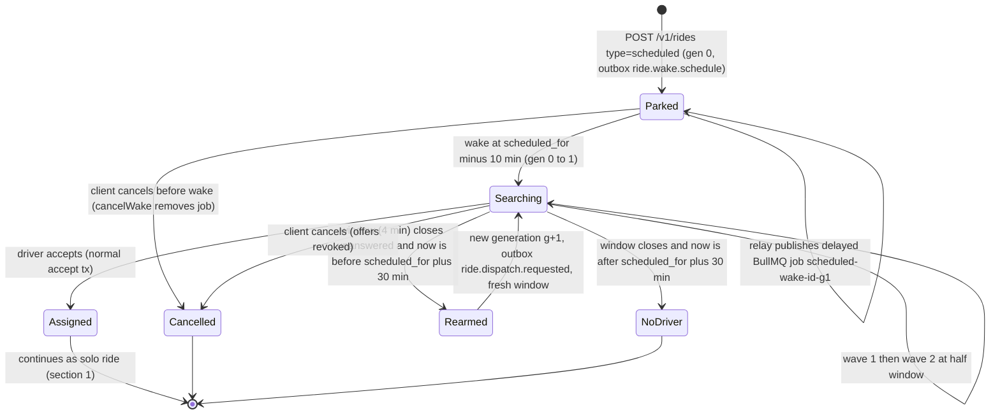

`Parked`, `Searching`, `Rearmed` are *phases of `rides.status = 'requested'`*, distinguished by
`dispatch_generation` (0 = parked, >=1 = searching) — not separate status values.

### Transition table

| From | Event | Who | Guard | To | Side effects | Emitted | Enforced in |
|---|---|---|---|---|---|---|---|
| — | create scheduled ride | client | lead time within `[minLeadMs, maxLeadMs]`; idempotency scope `ride.create.scheduled` | Parked (`requested`, gen 0) | outbox `ride.wake.schedule` g1 `{scheduledFor}` in the create tx | — | `rides.repository.ts#create` |
| Parked | relay drains outbox | system | row due + leased | Parked | `ScheduledDispatchService.scheduleWake` adds delayed BullMQ job `scheduled-wake-<ride>-g1` (delay = `scheduledFor - 10 min - now`, clamped to 0); deterministic id makes republish a no-op | — | `outbox.relay.ts`, `scheduled.service.ts` |
| Parked | wake job runs | system (`ScheduledDispatchProcessor`) | single guarded `UPDATE … WHERE type='scheduled' AND status='requested' AND dispatch_generation IN (g-1, g)` | Searching (gen 1) | then `startSolo` runs wave 1, arms wave-2 timer at `scheduled.dispatchWaveOneMs` (2 min) and window timer at `scheduled.dispatchWindowMs` (4 min) | `ride_offer` to drivers | `dispatch-start.service.ts#wakeScheduled` |
| Parked / Searching | `POST …/cancel` | client | same as section 1 (`dispatch_generation >= 1` decides whether it was "dispatching") | `cancelled` | controller also calls `ScheduledDispatchService.cancelWake` (best effort; the worker's status/generation guard is the real protection, test T26) | `ride_state_changed{cancelled}` | `rides.controller.ts`, `rides.repository.ts#cancel` |
| Searching | window timer (`HARD_FAIL_JOB`, delay = window) fires, no acceptance, **before cutoff** | system | ride unassigned `requested`, `type='scheduled'`, generation matches | Rearmed -> Searching (gen+1) | generation bumped, old offers revoked, outbox `ride.dispatch.requested` for the new generation; metric `rcab_dispatch_outcome_total{outcome="scheduled_retry"}` | `ride_offer_revoked` to old drivers; `ride_dispatch_retry{retryCount, retryUntil}` to the passenger **on the first re-arm only** | `scheduled/scheduled-retry.ts#rearmScheduledRide`, `dispatch.service.ts#retryScheduledRide` |
| Searching | window timer fires **after cutoff** (`now > scheduled_for + scheduled.retryCutoffAfterPickupMs`, 30 min) | system | same lock | `no_driver` | offers revoked; metric `outcome="scheduled_no_driver"` | `ride_no_driver`, `ride_state_changed{no_driver, by:'system'}` | same function; `afterScheduledNoDriver` |
| Searching | driver accepts | driver | as section 1 | `accepted` ... | as section 1 | as section 1 | `dispatch.service.ts` |
| any | Redis/BullMQ lost, job missing | system (reconciler, boot + every 5 min) | Postgres says work should exist but BullMQ has none | unchanged | re-arms the outbox intent / restores the timer; also ends/retries scheduled rides whose window lapsed while the api was down | — | `outbox/dispatch-reconciler.service.ts` |

The passenger sees `retryUntil` (the cutoff) in the `ride:snapshot`, so a reload still shows "we'll keep trying
until 10:30".

**Videos.** [W08](videos/web/INDEX.md#w08) (create, searching, cancel); recovery behaviour is exercised by the
integration specs `scheduled-dispatch.int.spec.ts`, `scheduled-retry.int.spec.ts`, `outbox-dispatch.int.spec.ts`.

**Drift notes.** Vault `features-scheduled-booking` and `sm-booking-flow.md` describe a single 4-minute window then
"failed"; the shipped behaviour is *retry until 30 min after pickup* (owner decision, RCAB-E8.S8/S13). The
`sm-booking-flow.md` diagram (`created`, `matching`, `matched`, `failed`, `scheduled_pending`) is conceptual and
does not correspond to any stored status.

---

## 3. Shared pool (`shared_rides.pool_state`)

A shared booking joins or opens a **pool** (`shared_rides`); the pool is dispatched to a driver as one trip with an
ordered multi-stop itinerary (`ride_stops`). States: `open`, `closed_full`, `closed_timeout`, `closed_started`,
`aborted`, `completed` (CHECK `shared_rides_state_check`). **"Claimed" is not a state**: it is
`claimed_by_driver_id IS NOT NULL` on a `closed_full` / `closed_timeout` pool.

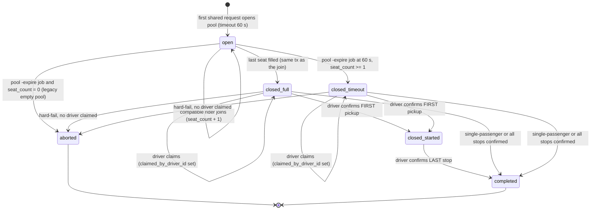

`state_version` (bigint) is bumped by a database trigger on **every** `UPDATE` of the row (including the
claim and each stop confirmation, which touch `updated_at`). Clients (web wrapper, driver app) drop any
`pool:update` / snapshot / stop echo whose `version` is not newer than what they applied.

### Transition table

| From | Event | Who | Guard | To | Side effects (one tx) | Emitted after commit | Enforced in |
|---|---|---|---|---|---|---|---|
| — | open pool (no compatible pool) | client | opener has no other active seat (`pool_member_one_active_pool_uq`); seat quoted *before* the tx (OSRM, no lock) | `open` | `shared_rides` insert (planned close = DB `now() + MATCHING_POOL_TIMEOUT_MS`), opener seat inserted, outbox `pool.expire.schedule` g0, idempotency record completed | `pool:update` (open) to `pool:<id>`; relay kick | `pool-lifecycle.service.ts#openPool` |
| `open` | join | client | pool `open` and `seat_count < max_seats`; `state_version` unchanged since the unlocked pricing snapshot (else re-price, <= `matching.joinPriceRetries`); no existing active seat | `open` | member insert (trigger `pool_member_require_open` re-checks state; `seat_count` derived by trigger), `agreed_fare_cents` fixed | `pool:update` | `#joinPool` |
| `open` | seat fills pool | client (the joining request) | `seat_count >= max_seats` after insert | `closed_full` | `closeOpen` (guarded on `open`), `pool_closed_at = now()`, **`dispatch_generation + 1`**, itinerary persisted to `ride_stops` (2 per member), outbox `pool.dispatch.requested` g(new) | `pool:update` (closed_full); relay kick | `#closeInTxn`, `shared-ride.repository.ts#closeOpen` |
| `open` | timeout job (`pool-expire-<id>`, queue `matching`) | system (`PoolExpireProcessor`) | pool still `open` (stale job = no-op) and `seat_count >= 1` | `closed_timeout` | as `closed_full` | `pool:update` (closed_timeout) | `#closeIfOpen` |
| `open` | timeout job, `seat_count = 0` | system | legacy empty pool | `aborted` | `abortEmptyOpen`; metric `aborted_empty` | `pool:update` | `#closeIfOpen` |
| `closed_*` (unclaimed) | dispatch start | system (`DispatchStartService.startPool`) | state in `closed_full/closed_timeout`, unclaimed, generation == job generation | same | offers created (section 5); wave-2 + hard-fail timers armed | `ride_offer` (shared payload with stops) | `dispatch-start.service.ts` |
| `closed_*` | driver accepts (claim) | driver | offer valid (section 5); `claimed_by_driver_id IS NULL`; state in `closed_full/closed_timeout`; `stops == 2 * seat_count`; driver vehicle seats >= `seat_count` | same state, **claimed** | `claimSharedRow` stamps `claimed_by_driver_id`/`claimed_at`; guard row inserted; other offers revoked | `ride_offer_accepted`/`ride_offer_outcome{assigned, assignment: itinerary}`, `pool:update` (claim, via snapshot service), `pool:<id>` projection refreshed | `dispatch.service.ts#acceptInTx` |
| `closed_*` (unclaimed) | hard-fail timer (60 s default) | system | unclaimed, generation matches | `aborted` | `abortUnclaimedPool`; offers revoked; **0016 trigger deactivates every member** (`active=false`, `left_at`); metric `pool_aborted`. Phase-0: members are *not* re-queued as solo rides (owner decision F-5) | `ride_offer_revoked`; versioned `pool:update` with terminal `aborted` | `dispatch.service.ts#handleHardFail` |
| `closed_full/closed_timeout` (claimed) | driver confirms stop 0 (a pickup) | bound driver (socket `stop:pickup_confirmed` request or REST) | caller == `claimed_by_driver_id`; stop is next unconfirmed (`out_of_order` otherwise); duplicate returns current state (T32) | `closed_started` | `confirmed_at` stamped, `markRideStarted`, `state_version` bumped | `stop:pickup_confirmed` echo to driver; `pool:update` (closed_started) | `ride-lifecycle.service.ts#confirmStop` |
| `closed_started` (or claimed `closed_*` with 0 pending) | driver confirms the last stop | bound driver | pending stops == 1 | `completed` | `completed_at`; **guard row deleted**; 0016 trigger deactivates members | `ride:completed` to `ride:<id>`, `stop:drop_confirmed` echo (`rideCompleted:true`), `pool:update` (completed); `current_ride_id` cleared | `#confirmStop`, `ride-stop.repository.ts#markRideCompleted` |

There is **no member-initiated leave or cancel for a pool seat** in Phase-0: the cancel endpoint only handles solo
`rides` rows. A member leaves only when the pool reaches `aborted` or `completed`.

**Videos.** [W07](videos/web/INDEX.md#w07) (two passengers: pool open -> closed_full -> claimed -> stops ->
completed) and [D06](videos/driver/INDEX.md#d06) (driver side: shared offer -> accept -> pickups/dropoffs).

**Drift notes.** Vault `30-domain/sm-shared-ride-pool.md` was out of date and is corrected in this change:
`open -> closed_started` and `open -> aborted` (non-empty) do not exist; `completed` was missing; the job id is
`pool-expire-<id>` (not `pool:expire:<id>`); `PoolLifecycleService.closePool` no longer exists
(`closeIfOpen` / `abortUnclaimedPool`); `closed_started` is fired by the first pickup confirmation, not by E4.S6.

---

## 4. Pool member (`pool_member.active`)

One row per `(pool_id, passenger_id)`, one seat each (CHECK `seats = 1`). All of this is database-enforced by the
0016 triggers, so a writer that forgot to lock still cannot corrupt a pool.

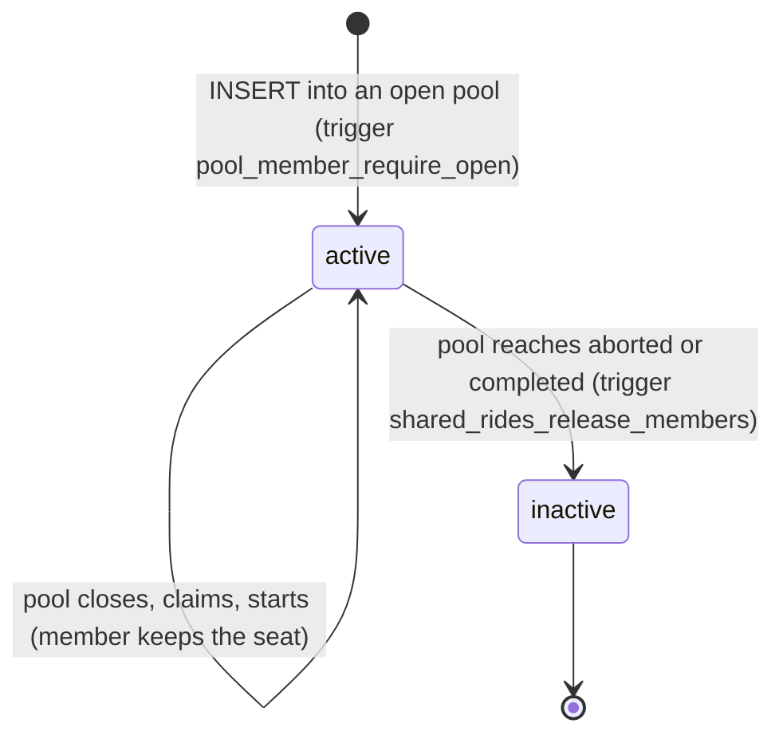

| From | Event | Guard | To | Side effects | Enforced in |
|---|---|---|---|---|---|
| — | insert member | pool `open` (else constraint `pool_member_pool_open`); `seat_count < max_seats` (shared_rides CHECK `shared_rides_seat_capacity_check`); passenger has no other active row (partial unique `pool_member_one_active_pool_uq`); `agreed_fare_cents` NOT NULL (trigger `pool_member_agreed_fare_guard`, 0017) | `active=true` | `seat_count += 1` (trigger); fare fixed at join (`fixed_at_join` stand-in policy) and immutable afterwards | `pool-membership.repository.ts#insertMember`, migrations 0016/0017 |
| `active` | pool -> `aborted` / `completed` | `OLD.pool_state IS DISTINCT FROM NEW.pool_state` | `active=false`, `left_at = now()` (CHECK `active = (left_at IS NULL)`) | frees the passenger's single-active-pool slot | trigger `shared_rides_release_members_trg` |
| `active` | attempt to change identity/seats | — | rejected | `pool_member_immutable_identity` trigger | migration 0016 |

Typed insert refusals surfaced to the API: `already_member`, `passenger_has_active_pool`, `pool_full`,
`pool_closed`, `idempotent_replay`. **Video:** [W07](videos/web/INDEX.md#w07).

---

## 5. Dispatch offer (`dispatch_offer.state`)

The authoritative offer record (migration 0014). Redis keys are at most a projection. One row per
`(trip, dispatch_generation, driver)`.

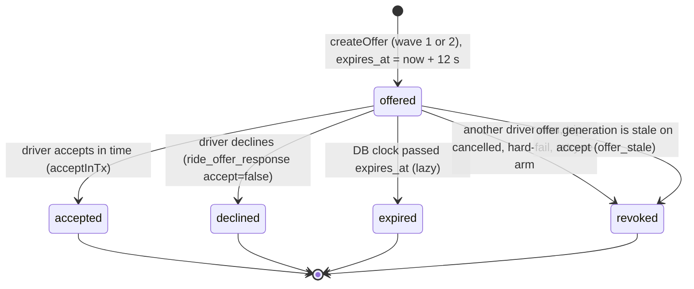

"**lost**" is not a stored state: it is the driver-facing *outcome* (`ride_offer_outcome{outcome:'lost'}`) sent to
drivers whose offer was `revoked` because *another driver won* (`reason:'taken'`). The stored value is `revoked`.

Expiry is **lazy** on the DB clock (`clock_timestamp()`): there is no per-offer timer. A lapsed `offered` row is
flipped to `expired` (a) by the same driver's next `createOffer` (frees the one-live-offer slot), (b) when the
driver tries to accept it (`offer_expired`), or (c) by the 30 s assignment reconciler (`expireLapsed`). Drivers are
not pushed an "expired" event; the app runs its own advisory countdown from `ttlMs`/`expiresAt`.

| From | Event | Who | Guard | To | Side effects | Emitted | Enforced in |
|---|---|---|---|---|---|---|---|
| — | `createOffer` | system (wave) | trip dispatchable at this generation (solo `requested`+unassigned; pool `closed_full/closed_timeout`+unclaimed) under `FOR SHARE`; driver has no live offer (partial unique `dispatch_offer_one_live_per_driver_uq`); not already offered this generation (`…_solo/shared_driver_uq`); driver eligible (active, no assignment, vehicle seats) | `offered` | `ttlMs = DISPATCH_OFFER_TTL_MS` (12 s) | `ride_offer` to that driver | `offer.repository.ts#createOffer`, `dispatch.service.ts#runSoloWave/runPoolWave` |
| `offered` | accept | driver | trip lock first, then offer lock; not lapsed; `generation == trip.dispatch_generation`; trip claimable; driver eligible; guard `acquire` succeeds | `accepted` | claim trip row; other live offers -> `revoked` | see section 1 / 3 | `dispatch.service.ts#acceptInTx` |
| `accepted` | accept replayed (ack lost) | driver | guard row still binds this driver, same generation | `accepted` (no change) | none; outcome re-sent | `ride_offer_outcome{assigned}` again | same |
| `offered` | decline | driver | own offer, still `offered` | `declined` | none; next wave will not re-offer this driver this generation | none (client already dismissed) | `offer.repository.ts#decline` |
| `offered` | accept after deadline | driver | `lapsed` (DB clock) | `expired` | refused `offer_expired` | `ride_offer_revoked{reason:'unavailable'}` + `ride_offer_outcome{expired}` | `acceptInTx` |
| `offered` | accept with older generation | driver | `offer.generation != trip.dispatch_generation` | `revoked` | refused `offer_stale` (maps to outcome `expired`) | as above | `acceptInTx` |
| `offered` | another driver accepted | system | — | `revoked` | `revokeLiveForTrip(trip, except winner)` | `ride_offer_revoked{reason:'taken'}` + `ride_offer_outcome{lost}` | `acceptInTx` + `notifyRevoked` |
| `offered` | trip cancelled / no_driver / pool aborted / scheduled re-arm | system | — | `revoked` | same revoke call in the cancelling tx | `ride_offer_revoked{reason:'revoked'}` + `ride_offer_outcome{revoked}` | `rides.repository.ts#cancel`, `markNoDriver`, `handleHardFail`, `rearmScheduledRide` |

Accept refusals (`AcceptOfferFailure`): `offer_not_found` (unknown or someone else's offer, no existence leak),
`offer_expired`, `offer_declined`, `offer_revoked`, `offer_stale`, `trip_taken`, `trip_not_claimable`,
`itinerary_missing`, `driver_busy`, `driver_ineligible`, `vehicle_capacity`, `conflict` (deadlock retries
exhausted; the offer stays live and the app may retry). Mapping to the UI outcome:
`outcomeForAcceptFailure` (api `realtime.protocol.ts`, mirrored in `offer_outcome.dart`).

**Videos.** [D04](videos/driver/INDEX.md#d04) (accept), [D05](videos/driver/INDEX.md#d05) (decline / expiry / lost),
[D06](videos/driver/INDEX.md#d06) (shared offer).

---

## 6. Driver presence

Presence is **not** a single stored enum. Three stores, with different roles:

| Store | Purpose | Authoritative for |
|---|---|---|
| Redis hash `driver:state:<id>` (`availability`, `last_seen`, `session_id`, `current_ride_id`) | liveness + a projection of the active trip | staleness sweep, reconnect replay |
| Redis GEO set `active_drivers` | cheap nearest-K candidate lookup | *advisory only* |
| Postgres `driver.availability` (`offline`/`online`/`on_ride` allowed by CHECK) | dashboards | nothing in dispatch |

"Busy" is **derived**: a driver is busy iff a `driver_active_assignment` row exists (section 7). Nothing writes
`driver.availability = 'on_ride'`, and a busy driver **stays in the geo set**; dispatch excludes them by an SQL
eligibility query (`eligibleCandidates`), not by removing them from Redis.

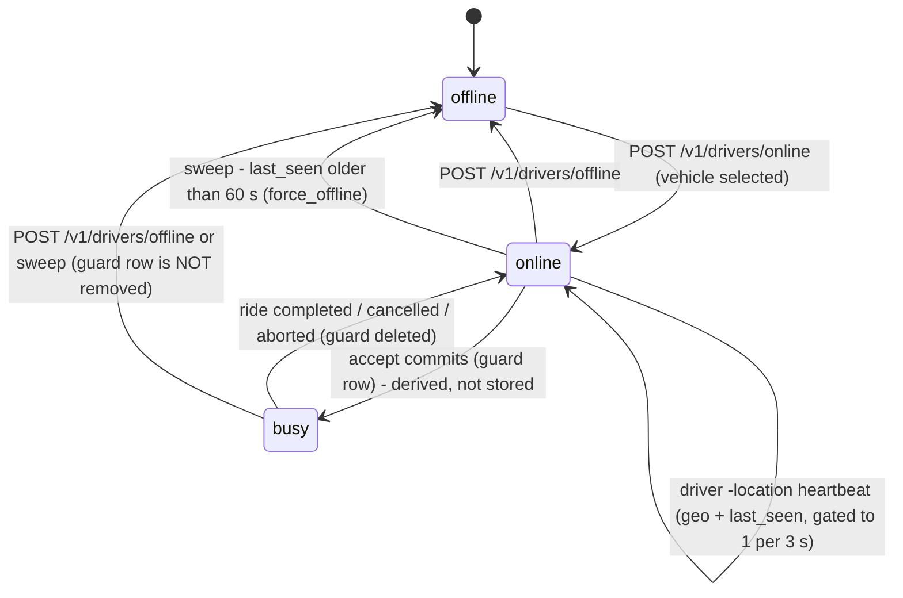

| From | Event | Guard | To | Side effects | Emitted | Enforced in |
|---|---|---|---|---|---|---|
| offline | `POST /v1/drivers/online {lat,lng}` | `driver.current_vehicle_id` set, else 400 `no_vehicle_selected` | online | `GEOADD active_drivers`, `HSET driver:state` (`availability`, `last_seen`, `session_id`), `driver.availability='online'` | `{ok, session_id}` | `drivers.service.ts#goOnline` |
| online | socket `driver:location` | authenticated driver socket | online | updates `last_seen` + geo at most once per `realtime.geoIndexGateMs` (3 s); if a `current_ride_id` is set, fans the position to `ride:<id>` at <= 1 Hz (`DRIVER_LOCATION_EVENT`) and, once per ride, raises `DRIVER_FIRST_LOCATION_EVENT` which auto-fires `start_en_route` (section 1) | `driver_location` to ride room | `realtime.gateway.ts#handleDriverLocation` |
| online | `POST /v1/drivers/offline` | — | offline | `ZREM`, `DEL driver:state`, `driver.availability='offline'` | — | `#goOffline` |
| online | auto-offline sweep (cron, every `DRIVER_AUTO_OFFLINE_SWEEP_MS` = 15 s) | `now - last_seen >= DRIVER_STALE_AFTER_MS` (60 s) | offline | same as `goOffline` | `force_offline{reason:'timeout'}` to driver | `#autoOfflineSweep` |
| any | reconnect | — | unchanged | `driver_state` replay + `driver:assignment` snapshot (committed assignment from Postgres) | `driver_state`, `driver:assignment` | `realtime.gateway.ts` |

Operational consequences you will hit: (1) **seeded fixture drivers go offline after ~60 s** unless
`./scripts/seed-dev.sh --keepalive` runs; (2) the sweep calls `goOffline` which deletes the whole
`driver:state:<id>` hash — including `current_ride_id` — for a driver who is mid-trip but silent; the 30 s
assignment reconciler re-projects it from the guard table; (3) a driver can go offline while holding a trip —
the trip is not touched.

**Video:** [D03](videos/driver/INDEX.md#d03). **Drift notes:** vault `30-domain/sm-driver-availability.md` claims
Redis is authoritative for dispatch, that `on_ride` is a stored state and that the geo entry is dropped on
accept; none of that is true of the code (corrected in this change).

---

## 7. Driver active assignment (the exclusivity guard)

`driver_active_assignment`: **PK `driver_id`** (at most one active trip per driver), **UNIQUE `solo_ride_id`** and
**UNIQUE `shared_ride_id`** (at most one driver per trip), `num_nonnulls(solo, shared) = 1`. It is the single
source of "this driver is busy".

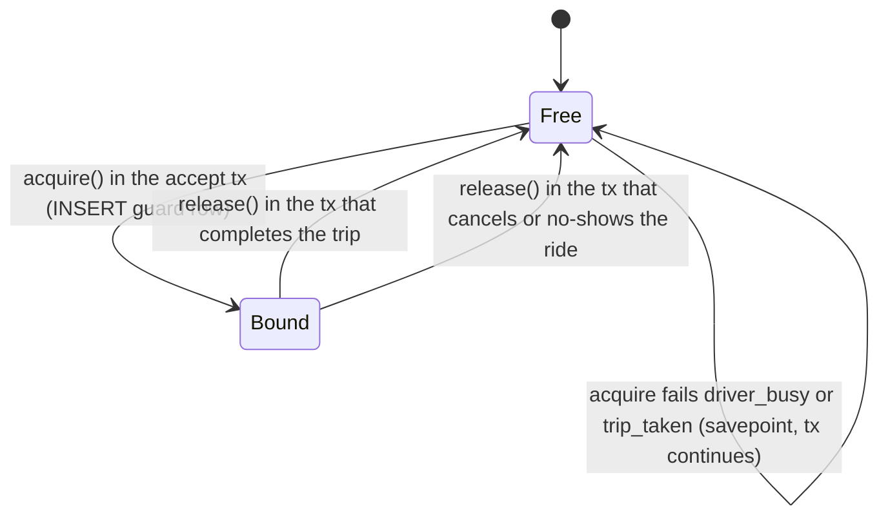

| From | Event | Guard | To | Constraint that decides | Enforced in |
|---|---|---|---|---|---|
| Free | accept / `claimSolo` | trip claimable | Bound | `INSERT` inside a savepoint; unique violation on driver PK -> `driver_busy`; on trip uniques -> `trip_taken` | `assignment.repository.ts#acquire` |
| Bound | `end_ride` (solo) | status `in_progress` | Free | delete where `driver_id` **and** that trip (a late release of trip X never frees trip Y) | `rides.repository.ts#transition` |
| Bound | last stop confirmed (shared) | pending == 0 | Free | same | `ride-lifecycle.service.ts#confirmStop` |
| Bound | cancel / no-show (solo) | bound driver exists | Free | same | `rides.repository.ts#cancel` |
| Bound | pool `aborted` | only reachable when **unclaimed**, so no guard exists | — | — | `handleHardFail` |

The Redis projection `driver:state:<id>.current_ride_id` is set after the accept commit and cleared (compare-and-
delete) after the releasing tx; `DriverAssignmentProjection` rebuilds it from this table at boot and every
`DISPATCH_ASSIGNMENT_RECONCILE_MS` (30 s). The `rcab_busy_drivers` gauge is `count(*)` of this table.
Pre-Stage-C double assignments were recorded in `migration_conflict` rather than guessed at — see
[`workflows/database-migrations.md`](workflows/database-migrations.md) and the recovery runbook section 6.
**Videos:** [D04](videos/driver/INDEX.md#d04), [D06](videos/driver/INDEX.md#d06), [D07](videos/driver/INDEX.md#d07).

---

## 8. Refresh-token session family

`auth_refresh_token` stores only the **SHA-256 digest** of the opaque refresh token. Every login mints a new
`family_id`; every rotation inherits it. Access tokens are short JWTs (`ACCESS_TOKEN_TTL_S`, 900 s); refresh
tokens live `REFRESH_TOKEN_TTL_MS` (30 days). Web and native use parallel routes (`/v1/auth/*`,
`/v1/auth/native/*`).

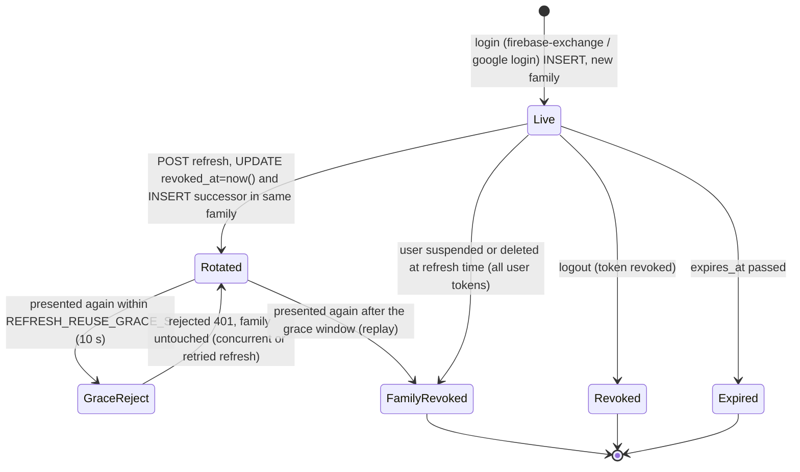

| From | Event | Guard (single SQL statement / tx) | To | Side effects | Error | Enforced in |
|---|---|---|---|---|---|---|
| — | `POST /v1/auth/firebase-exchange` (or `/native/…`) | Firebase ID token valid, `phone_number` E.164, `iat` within `FIREBASE_TOKEN_MAX_AGE_S` (3600), account not `suspended`/`deleted` | Live | find-or-create `app_user` (+`client`), insert hash row with fresh `family_id` | 401 `invalid_firebase_token`; 403 `account_disabled` | `auth.service.ts#exchangeFirebaseToken` |
| Live | `POST …/refresh` | `UPDATE … SET revoked_at=now() WHERE hash=$1 AND revoked_at IS NULL AND expires_at>now()` joined to an active user (atomic consume) | Rotated | successor row (same family) issued in the same tx | — | `#refresh` |
| Rotated | refresh with the consumed token, `revoked_at` newer than the grace window | zero rows consumed; family lookup finds `revoked_at > now() - grace` | (unchanged) | nothing revoked: the winning concurrent request already holds the successor | 401 `invalid_refresh_token` | `#refresh` |
| Rotated | refresh with the consumed token, `revoked_at` older than the grace window | same lookup finds `revoked_at <= now() - grace` | FamilyRevoked | every still-live token in the family revoked | 401 `invalid_refresh_token` | `#refresh` |
| Live | refresh for a user now `suspended`/`deleted` | `BLOCKED_USER_STATUSES` | Revoked (all of that user's live tokens) | no successor | 401 `account_disabled` | `#refresh` |
| Live | `POST …/logout` / `native/logout` (possession of the token is the credential) | — | Revoked | idempotent, silent | — | `#revoke`, `#revokePresented` |

Google link / login (`/v1/auth/google/*`) mints sessions with `auth_method='google'` using the same machine.
Refresh-token revocation lives in Postgres, **not Redis**. **Videos:** [W01](videos/web/INDEX.md#w01) /
[W02](videos/web/INDEX.md#w02) (sign-in UI), [W10](videos/web/INDEX.md#w10) (sign out), [D01](videos/driver/INDEX.md#d01).
Reuse/rotation is proved by `test/integration/auth.int.spec.ts`.

---

## 9. Outbox intent

The transactional outbox (migration 0015) makes "this trip needs dispatching / waking / expiring" **durable in the
same transaction as the business write**. A relay publishes intents to BullMQ with deterministic job ids; the
reconciler repairs anything Redis lost. **`processed_at` means "published to BullMQ", not "business work done"** —
the BullMQ job completes only after the worker actually ran wave 1.

Topics (`outbox.types.ts`): `ride.dispatch.requested`, `ride.wake.schedule`, `pool.dispatch.requested`,
`pool.expire.schedule`. Dedupe key `<topic>:<aggregateId>:g<generation>` (UNIQUE) = one intent per
(topic, row, generation).

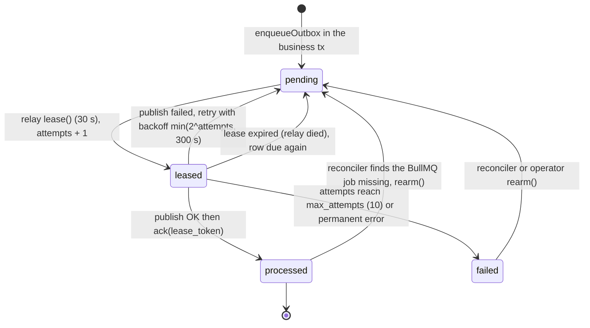

| From | Event | Guard | To | Side effects | Enforced in |
|---|---|---|---|---|---|
| — | `enqueueOutbox(tx, …)` | same tx as the ride/pool write; unique dedupe key | pending (`available_at = now()`) | — | `outbox.writer.ts` |
| pending | relay poll (`OUTBOX_RELAY_POLL_MS` 1 s, also `kick()` after commits) | `processed_at IS NULL AND failed_at IS NULL AND available_at <= now() AND (leased_until IS NULL OR < now())`, `FOR UPDATE SKIP LOCKED` | leased | `lease_token`, `leased_until`, `attempts + 1` (CHECK: token and until are both null or both set) | `outbox.repository.ts#lease` |
| leased | publish succeeded | `ack` fenced by `lease_token` | processed | `processed_at = now()`; metric `outbox_publish{published}` | `outbox.relay.ts` |
| leased | publish failed | `fail` fenced by `lease_token` | pending or failed | `last_error`, `available_at = now() + min(2^attempts,300)s`; `failed_at` set when `attempts >= max_attempts` or the error is permanent (unknown topic) | `#fail` |
| leased | lease lost (slow relay) | token mismatch | (another relay owns it) | ack/fail return `lost_lease`; the duplicate publish is absorbed by deterministic job ids | `#ack/#fail` |
| failed / processed | reconcile (boot + every `OUTBOX_RECONCILE_INTERVAL_MS` 5 min, ignores trips touched in the last `…GRACE_MS` 15 s) | Postgres says work should exist; BullMQ has no live job | pending | `rearm()` resets `processed_at/failed_at/attempts`; or writes a fresh intent | `dispatch-reconciler.service.ts` |

Watch `rcab_outbox_pending`, `rcab_outbox_oldest_pending_age_seconds`, `rcab_outbox_exhausted` (Grafana, scene
[M01](videos/ops/INDEX.md#m01); query demo [M02](videos/ops/INDEX.md#m02)). A non-zero `exhausted` needs a human:
see [`workflows/incident-and-recovery.md`](workflows/incident-and-recovery.md). Tests: `outbox-dispatch.int.spec.ts`,
`outbox-e2e.int.spec.ts`.

---

## 10. Idempotency record

Create operations are keyed by the client's `Idempotency-Key` header, **scoped to `(principal, operation, key)`** and
bound to a **request fingerprint** (a hash of the request's intent). Two storage forms:

- **Solo / scheduled create:** the key is a column pair on `rides` itself (unique `rides_idempotency_scope_uq`);
  the ride row *is* the record. A replay returns the existing ride, a different fingerprint is
  422 `idempotency_key_conflict`. Legacy rows with a NULL fingerprint replay for their owner only.
- **Shared create:** a row in `idempotency_record` (no single row of its own to carry the key) — the state machine
  below.

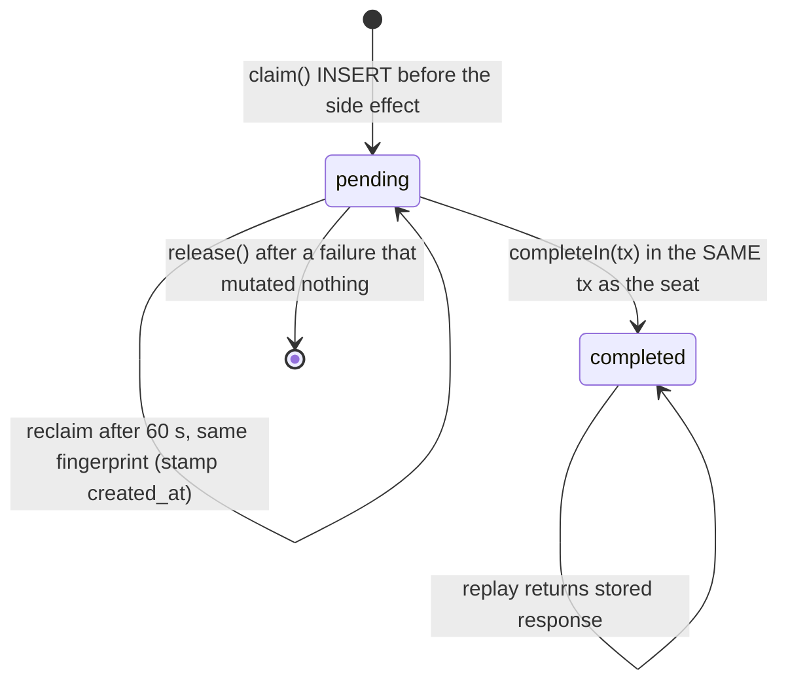

| From | Event | Guard | To / result | Enforced in |
|---|---|---|---|---|
| — | first use | PK `(principal_id, operation, idempotency_key)` -> exactly one concurrent winner | `pending`, caller proceeds (`claimed`) | `idempotency.repository.ts#claim` |
| `pending` | concurrent identical retry, claim younger than `IDEMPOTENCY_PENDING_RECLAIM_MS` (60 s) | — | caller gets 409 `idempotency_request_in_progress` | `idempotency.ts#idempotencyRequestInProgress` |
| `pending` | retry, claim older than 60 s, **same fingerprint** | compare-and-swap `UPDATE … created_at = now()` on a locked row | still `pending`, caller is `reclaimed`: it first looks for the seat the dead attempt may have created (by key) before repeating the side effect | `#reclaimStale`, `rides.controller.ts` |
| `pending` | side effect + `completeIn(tx)` commit together (shared create) | seat insert, `pool_member.idempotency_key`, record flip are one tx | `completed` with `response` + `resource_id` | `pool-lifecycle.service.ts#openPool/#joinPool` |
| `pending` | failure before any mutation | — | row deleted by `release()` so the client can retry the key | `#release` |
| `completed` | replay with same fingerprint | `fingerprintMatches` | stored response returned | controller |
| any | same key, different fingerprint | — | 422 `idempotency_key_conflict` | `idempotency.ts#fingerprintMatches` |

No purge job exists in Phase-0. The web client keeps one key per booking intent and rotates it only on a changed
intent or a confirmed success (`apps/web/src/lib/booking/intent.ts`). Tests: `rides.idempotency.spec.ts`,
`rides-idempotency.int.spec.ts`. (No video: it is invisible in the UI by design.)

---

## 11. Web booking stage machine

`apps/web/src/lib/booking/store.ts` (Zustand). Two coupled variables: `stage` (the booking request) and, once a
solo ride exists, `rideStatus` (mirrors the server's `rides.status`). Ride type toggle: `shared` | `private`
(`private` maps to API `normal`).

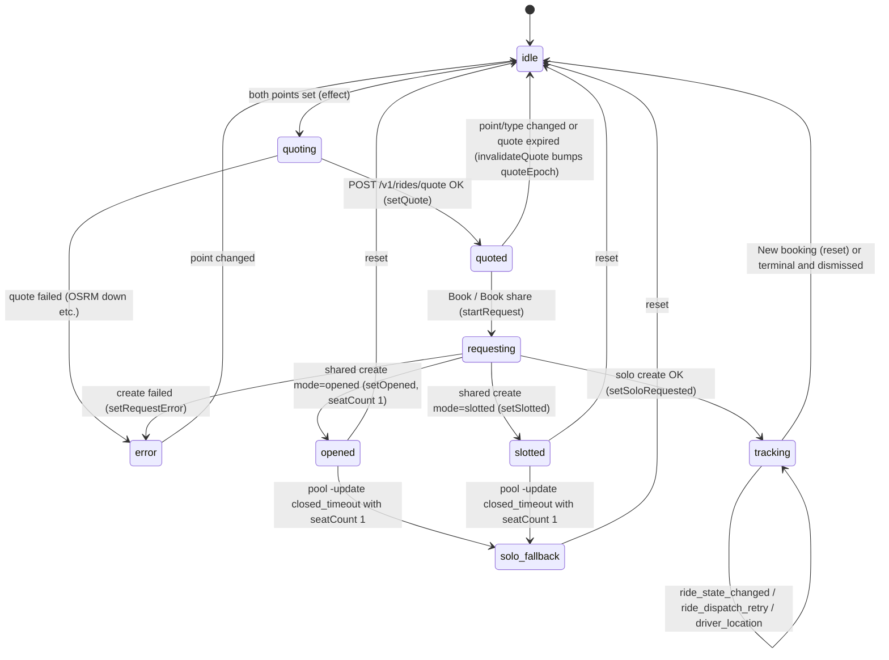

Rider-visible `rideStatus` (inside `tracking`): `requested` -> `accepted` -> `en_route` -> `arrived` ->
`in_progress` -> `completed`, or `cancelled` / `no_driver` / `no_show`. Unknown strings normalise to `requested`.
`isSearching(status)` is `requested | dispatching`; `searchRetry` (set from a snapshot or `ride_dispatch_retry`) turns
the banner into "still looking — we'll keep trying until …".

| From | Event | Guard / source | To | Notes | Code |
|---|---|---|---|---|---|
| idle | both endpoints set, authed | `quoteKey` = type + coords | quoting | one `AbortController` per run; superseded runs cannot apply state | `book-client.tsx` effect |
| quoting | quote response | `fetchQuote` | quoted | `quoteToken` (signed, 5 min) locks fare + route for the solo create | `store.ts#setQuote` |
| quoted | submit shared | `createSharedRide` + idempotency key | opened / slotted | server `mode` decides; agreed per-seat fare stored | `#submit` |
| quoted | submit solo | `createNormalRide(quoteToken)` | tracking | persists `rcab_active_ride` in `localStorage` | `#submitSolo` |
| quoted/requesting | 400 `quote_expired` | — | idle (re-quote) | key rotated | `createErrorMessage` |
| opened/slotted | `pool:update` | versioned (gate drops stale) | same, or solo_fallback | `closed_timeout` with 1 seat shows the fallback banner | `applyPoolUpdate` |
| tracking | `ride:snapshot` / `ride_state_changed` | version gate in `ws.ts` | tracking (new `rideStatus`) | non-searching status clears `searchRetry` | `applyRideState` |
| tracking | **page reload** | `localStorage` active ride -> `GET /v1/rides/:id`; socket re-sends `ride:subscribe` on every reconnect | tracking | terminal rides clear the marker (see drift note) | `book-client.tsx` restore effect |
| tracking | Cancel ride (hidden once `in_progress`) | `POST …/cancel`; 409 is benign, the socket reconciles | tracking -> `cancelled` | — | `cancelActiveRide` |
| any | Sign out | clears booking state, active-ride marker, pending key, then server logout | idle | — | `handleSignOut` |

Caveat on the shared "solo fallback": the UI banner promises *"continuing as private — updated fare"*, but the
server dispatches the single-member pool as a shared trip at the fare fixed at join (no re-price, no
conversion). See the issue list in the hand-off notes; behaviour change is an owner decision.

**Videos:** [W03](videos/web/INDEX.md#w03), [W04](videos/web/INDEX.md#w04), [W06](videos/web/INDEX.md#w06),
[W07](videos/web/INDEX.md#w07), [W08](videos/web/INDEX.md#w08), [W09](videos/web/INDEX.md#w09).

---

## 12. Driver app offer, ride and shared-ride controllers

Flutter + Riverpod. Each feature is a pure `StateNotifier` (unit-testable) plus a controller that bridges the
Socket.IO stream to the notifier and owns `go_router` navigation. **Server outcomes are authoritative**: an offer
is never treated as an assignment, and a snapshot (`driver:assignment`) heals any lost ack.

### 12.1 Solo offer (`OfferNotifier` / `OfferController`)

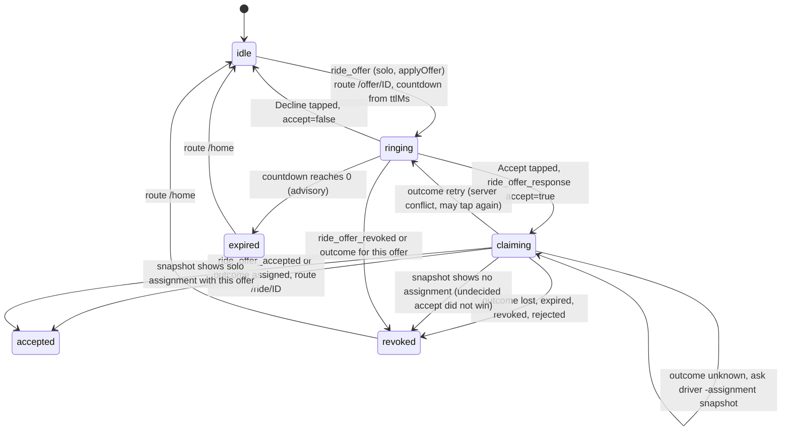

A loss never undoes a committed win (`applyRevoked` ignores `accepted`); late events for another `offerId` are
ignored. Cold start / reconnect: a solo `driver:assignment` snapshot routes straight to `/ride/:id`.

### 12.2 Solo ride (`RideNotifier`, `RideStatus`)

The driver view of section 1: `accepted -> enRoute -> arrived -> inProgress -> completed` via
`RideStatus.nextEvent` (`start_en_route`, `mark_arrived`, `start_ride`, `end_ride`) posted to
`POST /v1/rides/:id/state`; plus `cancel(reason)` and `reportNoShow()` (`POST …/cancel`). The server response is
authoritative; any error triggers `load()` (re-sync `GET /v1/rides/:id`). The no-show button is gated by the same
5-minute wait (`core/config/policy.dart`, mirrors `RIDE_NO_SHOW_WAIT_MS`) and re-validated server-side (409
`no_show_too_early`). After `completed`, route `/rating/:id`.

### 12.3 Shared trip (`SharedRideNotifier` / `SharedRideController`)

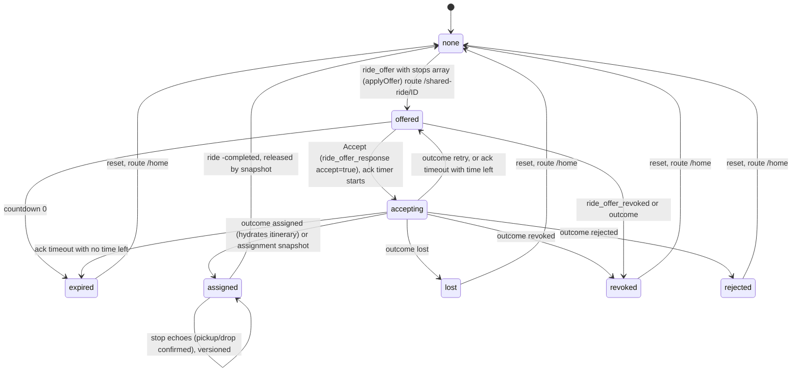

Stop commands are enabled **only** in `assigned`. `state_version` of echoes/snapshots is tracked per trip and
survives `reset` on purpose: a stale snapshot after a finished trip cannot resurrect it.

### 12.4 Auth and presence

`AuthState` = `Unauthenticated | Authenticated` (router redirect: unauthenticated -> `/sign-in`, authenticated on
`/sign-in` -> `/home`). `DriverState` = `DriverOffline | DriverOnline(vehicleId, sessionId)`; `goOnline` posts
`/v1/drivers/online`, starts the Android foreground service and the location bridge; `force_offline` from the
server (silence > 60 s) tears it down locally. `DriverOnRide` is declared in `driver_state.dart` but is **never
constructed** — being on a ride is represented by the offer/ride/shared-ride providers, not by `DriverState`.

**Videos:** [D01](videos/driver/INDEX.md#d01) sign-in, [D03](videos/driver/INDEX.md#d03) go online,
[D04](videos/driver/INDEX.md#d04) solo flow, [D05](videos/driver/INDEX.md#d05) decline/expiry/lost,
[D06](videos/driver/INDEX.md#d06) shared, [D07](videos/driver/INDEX.md#d07) cancel / no-show,
[D08](videos/driver/INDEX.md#d08) earnings and profile.

---

## Cross-machine invariants worth memorising

1. A driver has **at most one** `driver_active_assignment` row; a trip has at most one driver.
2. A passenger has **at most one active** `pool_member` row.
3. A pool's `seat_count` equals the number of its `pool_member` rows (trigger-derived), and `ride_stops` has exactly
   `2 * seat_count` rows once the pool is closed.
4. An offer/job/timer carries a **dispatch generation**; any work for an older generation is a no-op.
5. Every `ride.dispatch.requested` / `pool.dispatch.requested` outbox row has a matching BullMQ job *or* is
   re-armable (the reconciler's job).
6. Post-commit effects (sockets, Redis, timers) are best effort; Postgres rebuilds them.

The audit SQL for 1–3 lives in `docs/remediation/stage-c-contract.md` section 6 ("Invariant SQL", all queries must
return zero rows) and is executed by `scripts/recovery/restore-drill.sh` (I1–I9).
